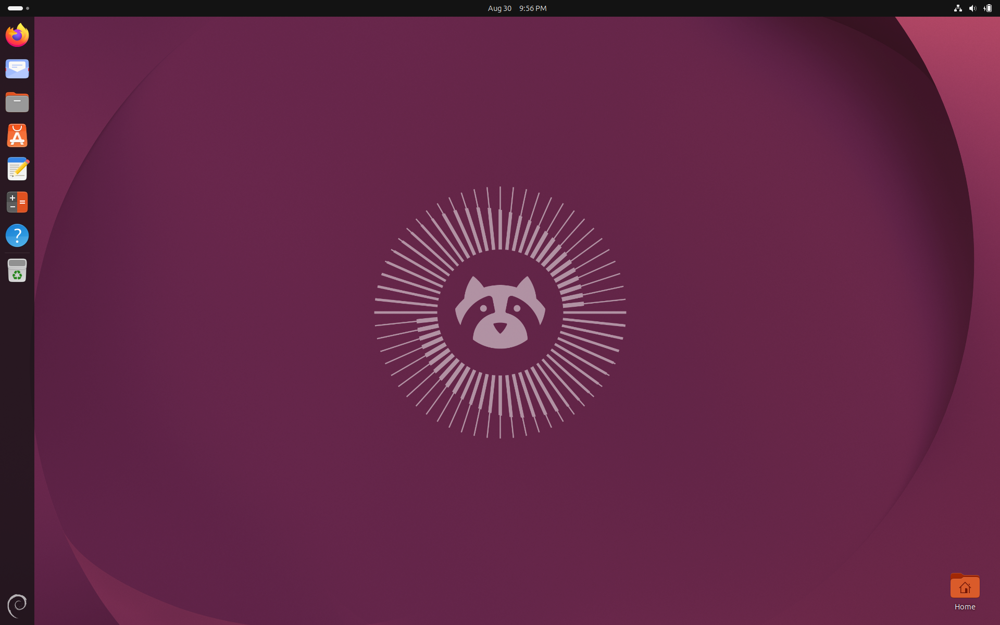
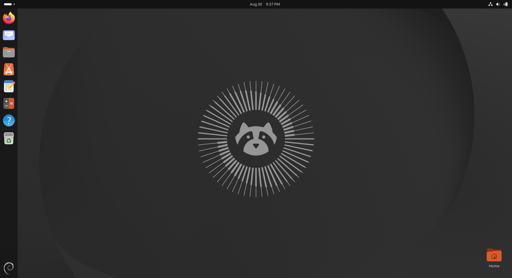
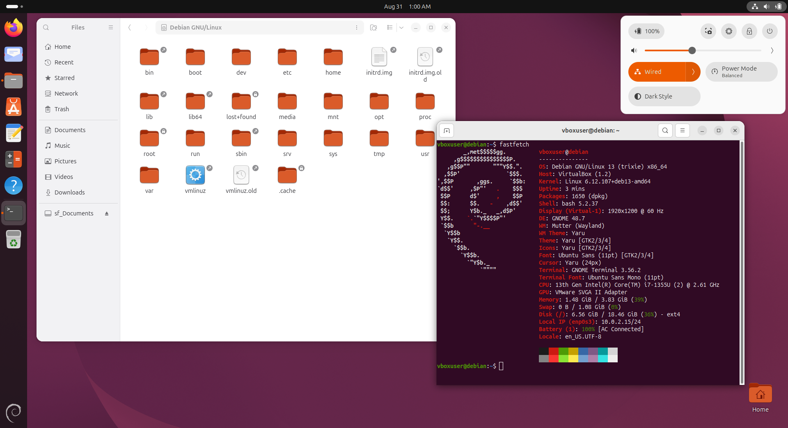
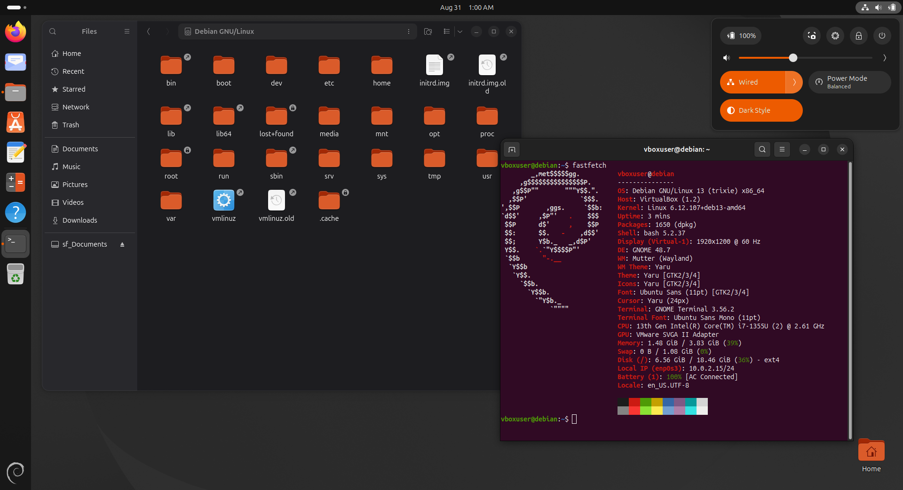

# ubuntu-look

Makes Debian GNOME look and behave like the newest Ubuntu release that
works with your GNOME Shell (the desktop itself), without breaking Debian.
It brings Yaru themes, Ubuntu fonts and wallpapers, Ubuntu Dock, the tiling
assistant, tray icons, desktop icons, Ubuntu's terminal colours, a Yaru
login screen, Ubuntu's boot splash and Ubuntu's desktop settings. As on
Ubuntu, it all comes as an **Ubuntu** session on the login screen, next to
Debian's GNOME session. No applications are installed.

> [!WARNING]
> **Use it at your own risk.** The script changes system packages, apt
> sources, the login screen and the boot settings. It is provided "as is",
> without warranty of any kind. The authors take no responsibility for
> data loss, a system that no longer starts, or any other damage. Read
> this page, back up what matters, and decide for yourself before you run
> it. See [LICENSE](LICENSE).






## Contents

- [Quick start](#quick-start)
- [Requirements](#requirements)
- [Commands](#commands)
- [Options](#options)
- [Which Ubuntu release you get](#which-ubuntu-release-you-get)
- [Where each feature comes from](#where-each-feature-comes-from)
- [Packages](#packages)
- [Desktop](#desktop)
- [Settings: Ubuntu's and Debian's](#settings-ubuntus-and-debians)
- [Staying up to date](#staying-up-to-date)
- [Reset](#reset)
- [Upgrading Debian](#upgrading-debian)
- [Uninstall](#uninstall)
- [Troubleshooting](#troubleshooting)
- [How it works](#how-it-works)
- [Don't break Debian](#dont-break-debian)
- [Tests](#tests)

**How commands are written on this page:** each command is one line. The
part in **bold** is the value you choose; type the rest as shown.

## Quick start

1. Download `ubuntu-look.sh` (or clone this repository).
2. Open a terminal in its folder, inside your desktop session, and run:

   ```bash
   bash ubuntu-look.sh
   ```

3. Read what it will do, type `y` and press Enter, then enter your
   password when asked.
4. The script reboots at the end, after a 60 second countdown: press
   Enter to reboot at once, Ctrl-C to cancel.

Good to know:

- The script asks at the terminal, so answers piped into it
  (`yes | bash ubuntu-look.sh`) are not used; without a terminal every
  question counts as no.
- Running it again is safe for the system. A plain run also resets your
  own values of the look's settings; see [Reset](#reset).
- To undo the look, see [Uninstall](#uninstall).

## Requirements

| Requirement             | Detail                                                   |
|-------------------------|----------------------------------------------------------|
| System                  | Debian with GNOME                                        |
| Processor               | a type Ubuntu supports (amd64, arm64 and others)         |
| User                    | a normal account with sudo rights; do not run it as root |
| Network                 | internet access                                          |
| GNOME Shell 45 or later | for the Yaru shell theme, style switching, Yaru login    |
| GNOME Shell 47 or later | for the accent colour                                    |

## Commands

<pre>
bash ubuntu-look.sh              # install or update, and reset the look's settings
bash ubuntu-look.sh <b>--refresh</b>    # list updates, ask, then update and repair; resets nothing
bash ubuntu-look.sh <b>--reset</b>      # reset the look's settings of an installed look
bash ubuntu-look.sh <b>--uninstall</b>  # undo the look
bash ubuntu-look.sh <b>--help</b>       # commands and options (also -h)
</pre>

| Command               | What it does                      | The look's settings | Your files |
|-----------------------|-----------------------------------|---------------------|------------|
| `bash ubuntu-look.sh` | installs, or repairs and updates  | reset to Ubuntu's   | kept       |
| `--refresh`           | lists updates, asks, then updates | kept                | kept       |
| `--reset`             | repairs and updates               | reset to Ubuntu's   | kept       |
| `--uninstall`         | removes the look                  | reset to Debian's   | kept       |
| `--help`, `-h`        | prints commands and options       | kept                | kept       |

- Give only one of `--refresh`, `--reset` and `--uninstall`.
- `--refresh` and `--reset` work only after the look is installed.
- Run `--reset` and `--uninstall` from a terminal in your desktop session,
  so your settings can be reset.
- `--uninstall` removes the Ubuntu session and everything the script
  installed; Debian's own GNOME session remains.
- **The look's settings** are the ones the look sets: wallpaper, theme,
  fonts, window buttons, keybindings, terminal colours, power settings,
  and the settings of the dock and the other extensions it brings. The
  values a reset removes are not kept. An extension you have a build of
  your own of (Dash to Dock from Debian or from extensions.gnome.org, say)
  keeps its settings.
- **Your files** are your files, folders, installed apps and every setting
  the look does not set, such as favourites, keyboard layouts and app
  settings. No command changes them.

What the script deletes in your home folder is its own:

| In your home folder                       | Deleted                                  |
|-------------------------------------------|------------------------------------------|
| `ubuntu-look-<command>-<date>-<time>.log` | all but the newest ten of each command   |
| the same run logs                         | all, once an uninstall is complete       |
| `~/.config/tiling-assistant/`             | on `--uninstall`                         |
| `~/.local/share/session_migration-*`      | on `--uninstall`                         |
| `~/.local/share`, `~/.local`              | on `--uninstall`, only if they are empty |
| `~/.ubuntu-look-backup`                   | on `--uninstall`                         |

- `~/.config/tiling-assistant/` is the window layout the look's tiling
  assistant stored.
- The `session_migration-*` markers exist where the look brought
  `session-migration`.
- `~/.ubuntu-look-backup` is a folder version 1.0 left; version 1.1 keeps
  none.

## Options

Options are settings placed in front of the command. Several can be given
at once, separated by spaces:

<pre>
<b>UBUNTU_BOOT_SPLASH=0</b> <b>UBUNTU_LOOK_ANIMATIONS=0</b> bash ubuntu-look.sh
</pre>

A value that is not accepted stops the run before it changes anything.

**Remembered options.** A finished install saves these four, and later
runs use them again until you give a new value.

| Option               | Sets                    | Default          | Accepted values     |
|----------------------|-------------------------|------------------|---------------------|
| `UBUNTU_CODENAME`    | the Ubuntu release used | `auto`           | `auto`, a code name |
| `UBUNTU_MIRROR`      | the download server     | Ubuntu's archive | one web address     |
| `UBUNTU_BOOT_SPLASH` | the boot splash         | `1`              | `0`, `1`            |
| `PLYMOUTH_THEME`     | the boot splash theme   | `bgrt`           | an installed theme  |

**One-run option.** It applies only to the run it is given to.

| Option                   | Sets              | Default | Accepted values |
|--------------------------|-------------------|---------|-----------------|
| `UBUNTU_LOOK_ANIMATIONS` | animation effects | not set | `0`, `1`        |

**Not options.** These are fixed, and nothing changes them:

| Behaviour         | Fixed to                                         |
|-------------------|--------------------------------------------------|
| Ubuntu release    | released versions only, never one in development |
| Upgrades          | the look's own packages only                     |
| Run log           | always written                                   |
| Reboot at the end | always, after a 60 second countdown              |

- The rest of the system is left to your own `apt upgrade`.
- `UBUNTU_INCLUDE_DEVEL`, `UBUNTU_LOOK_SYSTEM_UPGRADE`, `UBUNTU_LOOK_LOG`
  and `UBUNTU_LOOK_REBOOT` were options of earlier versions. A run given
  one of them stops before it changes anything and says so.
- See [Run log](#run-log) and [Reboot](#reboot).

### `UBUNTU_CODENAME`

The Ubuntu release the look is taken from, named by its code name.

| Value                      | Meaning                                       |
|----------------------------|-----------------------------------------------|
| `auto` (default)           | the newest release that fits your GNOME Shell |
| a code name, in lower case | that release                                  |
| `devel`                    | refused: it names no release                  |
| a release in development   | refused                                       |

- Code names are, for example, `noble`, `plucky`, `questing`, `resolute`
  and `stonking`; see
  [Which Ubuntu release you get](#which-ubuntu-release-you-get). The
  release must be published on the mirror or on Ubuntu's old-releases
  archive.
- A release made for another GNOME Shell may leave out the dock or the
  shell theme; the summary says which.
- Only released versions are used. The release in development is the one
  the archive's `devel` link names, checked against Ubuntu's own list of
  releases.

<pre>
UBUNTU_CODENAME=<b>noble</b> bash ubuntu-look.sh   # use Ubuntu 24.04
UBUNTU_CODENAME=<b>auto</b> bash ubuntu-look.sh    # back to automatic
</pre>

### `UBUNTU_MIRROR`

The server the Ubuntu packages are downloaded from.

| Value                                            | Meaning                  |
|--------------------------------------------------|--------------------------|
| `http://archive.ubuntu.com/ubuntu` (default)     | on amd64 and i386        |
| `http://ports.ubuntu.com/ubuntu-ports` (default) | on other processor types |
| one `http://` or `https://` address              | that server              |
| an address with a user name or password          | refused                  |

The address is shown in the run log and stored in files every user can
read, which is why it takes no user name or password.

<pre>
UBUNTU_MIRROR=<b>http://de.archive.ubuntu.com/ubuntu</b> bash ubuntu-look.sh
</pre>

### `UBUNTU_BOOT_SPLASH`

The boot splash: the logo shown while the computer starts. With GRUB only.

| Value         | Meaning                                       | Same as |
|---------------|-----------------------------------------------|---------|
| `1` (default) | adds the splash                               | Ubuntu  |
| `0`           | no splash; removes one the look added earlier | Debian  |

Ubuntu starts with `quiet splash` in its start-up options, Debian with
`quiet` only.

<pre>
UBUNTU_BOOT_SPLASH=<b>0</b> bash ubuntu-look.sh   # no boot splash
UBUNTU_BOOT_SPLASH=<b>1</b> bash ubuntu-look.sh   # boot splash, as on Ubuntu
</pre>

### `PLYMOUTH_THEME`

The boot splash theme.

| Value                        | Meaning                                         |
|------------------------------|-------------------------------------------------|
| `bgrt` (default)             | Ubuntu's: the computer maker's logo and spinner |
| the name of an installed one | that theme, for example `spinner`               |

- To list the installed themes: `/usr/sbin/plymouth-set-default-theme -l`
- A name is made of letters, digits and `.` `_` `+` `-`.
- A theme you name that is not installed is reported, and the theme stays
  as it is.

<pre>
PLYMOUTH_THEME=<b>spinner</b> bash ubuntu-look.sh   # another theme
PLYMOUTH_THEME=<b>bgrt</b> bash ubuntu-look.sh      # Ubuntu's theme again
</pre>

### `UBUNTU_LOOK_ANIMATIONS`

Animation effects, for your user only. It is the same switch as
Settings → Accessibility → Seeing → Reduce Animation.

| Value             | Meaning                        |
|-------------------|--------------------------------|
| not set (default) | animations stay as they are    |
| `1`               | on, as in Ubuntu and in Debian |
| `0`               | off                            |

- Without the option nothing is changed: later runs and the uninstall
  keep your choice.
- The option works with every run, the uninstall included.

The one switch covers all of these:

| Animation                                   | Where                                 |
|---------------------------------------------|---------------------------------------|
| opening, closing, minimising and maximising | windows                               |
| switching                                   | workspaces                            |
| opening and closing                         | the Activities overview, the app grid |
| showing, hiding and icon effects            | Ubuntu Dock                           |
| tile and untile movement                    | the tiling assistant                  |
| transitions                                 | inside GTK apps                       |

<pre>
UBUNTU_LOOK_ANIMATIONS=<b>0</b> bash ubuntu-look.sh               # off
UBUNTU_LOOK_ANIMATIONS=<b>1</b> bash ubuntu-look.sh               # on
UBUNTU_LOOK_ANIMATIONS=<b>0</b> bash ubuntu-look.sh --uninstall   # off, while uninstalling
</pre>

### Run log

Every run that changes the system writes a log to your home folder. It
cannot be switched off.

- The file is named `ubuntu-look-<command>-<date>-<time>.log`, for
  example `ubuntu-look-install-20260928-151900.log`.
- The newest ten of each command are kept.
- A run you declined, or one refused before it changed anything, keeps no
  log. A complete uninstall removes them all.

### Reboot

A run that changed the system reboots at the end, after a 60 second
countdown. It cannot be switched off.

| Situation                                   | What happens                    |
|---------------------------------------------|---------------------------------|
| the run changed the system, nothing is left | countdown, then reboot          |
| Enter during the countdown                  | reboots at once                 |
| Ctrl-C during the countdown                 | cancels the reboot              |
| the terminal is closed during the countdown | no reboot                       |
| the run changed nothing                     | no reboot; the command is named |
| a step could not finish                     | no reboot                       |
| no terminal                                 | no countdown, no reboot         |

A run that changed nothing does not count down even when an earlier run
still owes a reboot. Run `sudo reboot` when you are ready.

## Which Ubuntu release you get

The script uses the newest released Ubuntu whose look installs on your
Debian's own GNOME Shell. It finds that out on every run, by simulating
the install of each release's Yaru shell theme and dock, newest first.
Debian's GNOME Shell is never replaced, so its version sets the limit.

The tables show the state of both archives on 14 November 2026.

Debian:

| Suite   | Release      | GNOME Shell |
|---------|--------------|-------------|
| stable  | trixie, 13.7 | 48.7        |
| testing | forky        | 51.0        |

Ubuntu ("Shell" is GNOME Shell):

| Release            | Status                | Shell | Theme needs Shell | Extensions need Shell |
|--------------------|-----------------------|-------|-------------------|-----------------------|
| 25.04 plucky       | released, unsupported | 48.0  | 48 or later       | 48                    |
| 25.10 questing     | released, unsupported | 49.0  | 49 or later       | 48 or 49              |
| 26.04 LTS resolute | released, supported   | 50.1  | 49 or later       | 49 or 50              |
| 26.10 stonking     | released, the newest  | 51.0  | 49 or later       | 50 or 51              |
| 27.04 tenacious    | in development        | 51.0  | 49 or later       | 50 or 51              |

"Unsupported" means no longer supported by Ubuntu. "Theme" is the Yaru
shell theme.

What you get:

| Debian             | GNOME Shell | Ubuntu release used |
|--------------------|-------------|---------------------|
| 13 trixie (stable) | 48.7        | 25.04 plucky        |
| forky (testing)    | 51.0        | 26.10 stonking      |

- **Debian 13:** from 25.10 on, Yaru's shell theme package breaks GNOME
  Shell below 49, so apt cannot install it. Ubuntu 25.04 is past Ubuntu's
  support period, so its look packages get no further updates from
  Ubuntu. It stays the newest release Debian 13's GNOME Shell can take.
- **forky:** 26.10 is the newest released Ubuntu; its theme and extensions
  accept GNOME Shell 51.
- A release in development is never used.

## Where each feature comes from

The aim is Ubuntu's real look, style and behaviour, taken from the Ubuntu
release itself, on a Debian that stays Debian.

### From real Ubuntu

"Read" means the script downloads that Ubuntu package, reads it and does
not install it.

| Feature                             | Taken from Ubuntu's                        | How       |
|-------------------------------------|--------------------------------------------|-----------|
| Which Ubuntu release is used        | Yaru shell theme and dock of each release  | simulated |
| GTK theme, icons, cursor, sounds    | Yaru packages                              | installed |
| GNOME Shell theme                   | Yaru shell theme package                   | installed |
| Ubuntu fonts                        | font package                               | installed |
| Wallpapers                          | wallpaper packages                         | installed |
| Wallpaper file names                | `ubuntu-settings`                          | read      |
| Ubuntu Dock, tiling assistant       | extension packages                         | installed |
| Tray icons, desktop icons           | extension packages                         | installed |
| Web search provider                 | extension packages                         | installed |
| Other look packages of the desktop  | `ubuntu-desktop-minimal`, `ubuntu-session` | installed |
| Desktop settings                    | `ubuntu-settings`                          | read      |
| New defaults of a later release     | `ubuntu-settings`                          | read      |
| Light or dark style                 | `gnome-shell-common`, `ubuntu-settings`    | read      |
| Login screen theme and fonts        | `ubuntu-settings`                          | read      |
| Session name and comment            | `ubuntu-session`                           | read      |
| Session mode                        | `gnome-shell-common`                       | read      |
| Terminal colours                    | installed Yaru theme                       | read      |
| Terminal shortcut's key combination | `gnome-settings-daemon-common`             | read      |
| Font smoothing                      | `fontconfig-config`                        | read      |

- **Which release:** each release is tried newest first by a simulated
  install.
- **Extensions** come with their own default settings.
- **Other look packages** are a new theme, font or extension package of
  Ubuntu's desktop. They are installed when apt's simulation is clean.
- **Desktop settings** are fonts, window buttons, shortcuts, power,
  touchpad and the rest.
- **New defaults** are applied where this Debian has the software.
- **Session mode** is the stylesheet, theme, style and the extensions
  started.
- **Terminal colours** are read from the Yaru theme's rule for the
  terminal.
- **Font smoothing** uses the standard fontconfig files Ubuntu enables;
  Debian's own copies are used.

### Not Ubuntu's, by choice

| Feature                           | What you get instead   | Reason                          |
|-----------------------------------|------------------------|---------------------------------|
| Ubuntu's logo                     | Debian's logo, or none | left out on purpose             |
| Boot splash                       | Debian's own Plymouth  | the boot stays Debian's         |
| Hidden boot menu                  | the menu is shown      | a failed boot keeps its menu    |
| Canonical's services              | not applied            | not part of the look            |
| Extensions named `@canonical.com` | not started            | they need Canonical's software  |
| Dock favourites                   | yours are kept         | Ubuntu's apps are not in Debian |
| Debian's own GNOME session        | unchanged              | the look has its own session    |
| Session of a new user             | Debian's GNOME session | as on Ubuntu                    |

- **Ubuntu's logo** would show on the login screen, the Show Applications
  button and the on-screen keyboard's Super key.
- **Boot splash:** Debian's Plymouth is used with the kind of theme Ubuntu
  uses.
- **Boot menu:** Ubuntu hides it; on Debian that could leave a failed boot
  without a menu.
- **Canonical's services** are the web search defaults, the Firefox
  partner, the key server and the update notifier.
- **`@canonical.com` extensions** are snapd's and others.
- **Debian's GNOME session** keeps Debian's defaults. Ubuntu's settings
  package is read, never installed: installed, it would change Debian's
  session too.
- **New users** start in Debian's GNOME session, as on Ubuntu when GNOME's
  own session is installed; they pick Ubuntu once on the login screen.

### Not Ubuntu's, because it cannot be

| Feature                               | What you get instead                    |
|---------------------------------------|-----------------------------------------|
| Yaru's shell icons                    | a small extension written by the script |
| Dark style switch, accent colours     | the same extension                      |
| Login screen theming                  | a login screen extension by the script  |
| What makes the terminal shortcut work | a normal custom shortcut                |
| The session's list of components      | Debian's own GNOME session              |
| The session entry, session mode files | written by the script                   |
| The apt hook                          | written by the script                   |

- **Shell icons, style switch, accents, login screen:** on Ubuntu these
  are inside its patched GNOME Shell, which would replace Debian's. The
  script's extension uses Yaru's real files.
- **Terminal shortcut:** Ubuntu's patched settings daemon handles that
  key; Debian's has no such key.
- **List of components:** it must match Debian's settings daemon. Ubuntu's
  list differs and could stop the session from starting.
- **Session files:** Ubuntu's `ubuntu-session` package requires Ubuntu's
  exact build of `gnome-session`, so it cannot be installed. The files are
  written from Debian's entries and Ubuntu's values.
- **apt hook:** it is not Ubuntu's. It takes the Ubuntu session off the
  login screen when GNOME Shell changes, so Debian always logs in.

### Missing

| Feature                                 | It is part of                            |
|-----------------------------------------|------------------------------------------|
| The Ubuntu Desktop page in Settings     | Ubuntu's patched Settings app            |
| Yaru's exact accent shades, in places   | Ubuntu's patched libadwaita, GNOME Shell |
| Terminal transparency                   | Ubuntu's patched Terminal                |
| Backspace going back in Files           | Ubuntu's patched Files                   |
| Dock menus of Rhythmbox and Videos      | Ubuntu's patched builds of those apps    |
| Rhythmbox hiding, not quitting, in play | Ubuntu's patched Rhythmbox               |
| The name "Image Viewer" for eog         | Ubuntu's patched eog                     |
| Snap Store and snap apps                | snapd and Canonical's store              |

- In place of the Ubuntu Desktop page, the dock has its own settings
  window; see [Ubuntu Dock](#ubuntu-dock).
- Apps keep Debian's builds. Browsers and mail apps follow the Yaru theme
  on their own, as on Ubuntu.

## Packages

| Package                                         | Purpose                   | From   |
|-------------------------------------------------|---------------------------|--------|
| `yaru-theme-gtk`                                | Yaru theme for apps       | Ubuntu |
| `yaru-theme-icon`                               | Yaru icons                | Ubuntu |
| `yaru-theme-sound`                              | Yaru sounds               | Ubuntu |
| `yaru-theme-gnome-shell`                        | Yaru desktop shell theme  | Ubuntu |
| `fonts-ubuntu`                                  | Ubuntu fonts              | Ubuntu |
| `ubuntu-wallpapers`, the release's own set      | wallpapers                | Ubuntu |
| `gnome-shell-extension-ubuntu-dock`             | Ubuntu Dock               | Ubuntu |
| `gnome-shell-extension-ubuntu-tiling-assistant` | window tiling             | Ubuntu |
| `session-migration`                             | required by Yaru          | Ubuntu |
| `libreoffice-style-yaru`                        | LibreOffice style         | Ubuntu |
| `gnome-shell-extension-appindicator`            | tray icons in the top bar | Debian |
| `gnome-shell-extension-desktop-icons-ng`        | files on the desktop      | Debian |
| `rhythmbox-plugin-alternative-toolbar`          | Rhythmbox toolbar         | Debian |
| `gnome-session-canberra`                        | login screen sound        | Debian |
| `plymouth`, `plymouth-themes`                   | boot splash               | Debian |
| `dconf-cli`                                     | settings tool             | Debian |
| `ubuntu-keyring`                                | Ubuntu's signing keys     | Debian |
| `curl`, `ca-certificates`                       | download tools            | Debian |

- `libreoffice-style-yaru` is installed only when LibreOffice is
  installed, `rhythmbox-plugin-alternative-toolbar` only when Rhythmbox
  is. After installing either app, run the script again for its Ubuntu
  style.
- `plymouth` and `plymouth-themes` are left out with
  `UBUNTU_BOOT_SPLASH=0`.
- `curl` and `ca-certificates` are installed if missing. The uninstall
  keeps them.
- `session-migration` contains a compiled program; the script keeps its
  user service switched off.
- `gnome-session-canberra` plays Yaru's sound when the login screen is
  ready. Its login sound is off, as on Ubuntu.
- `ubuntu-keyring` is what apt uses to check the Ubuntu packages.
- Some Ubuntu releases ship Ubuntu Dock, the tiling assistant, tray icons
  and desktop icons as one package, `gnome-shell-ubuntu-extensions`. When
  the chosen release has it, the script installs it instead of the four
  separate packages. When the package carries Ubuntu's web search
  provider extension, that runs too, as on Ubuntu. The uninstall puts
  back the Debian packages it replaced.

## Desktop

Run the script from your desktop session. It adds the **Ubuntu** session
for every user and chooses it for you. The Ubuntu look appears only in the
Ubuntu session; Debian's GNOME session keeps Debian's defaults. Settings
you make yourself apply in both sessions, as on Ubuntu. The login screen
and the boot splash are shared by all users.

- **Session:** the login screen offers Ubuntu and Ubuntu on Xorg, next to
  GNOME and GNOME on Xorg. Ubuntu is a Wayland session on Debian's own
  GNOME Shell and Mutter. To switch, select your name, then the gear
  button, then Ubuntu or GNOME; the login screen remembers the choice. A
  plain run and `--reset` choose Ubuntu for you, and leave Ubuntu on Xorg
  if that is what you picked; `--refresh` keeps whatever you picked, GNOME
  included.
- **Settings:** Ubuntu's desktop settings, as defaults of the Ubuntu
  session, for every user. Values you set yourself win over Ubuntu's, as
  on Ubuntu, until the next [reset](#reset); after `--refresh` the summary
  lists them.
- **Shell theme and extensions:** GNOME Shell starts in Ubuntu's session
  mode, `ubuntu`, as on Ubuntu. The mode loads Yaru and starts the dock,
  tray icons, desktop icons and tiling assistant before anything is
  drawn, so the panel, dock and desktop icons do not move after login.
  As on Ubuntu, Yaru alone styles the dock. To turn one of these
  extensions off, use the Extensions app.
- **Dock:** as on Ubuntu, if you have Dash-to-Dock turned on, Ubuntu Dock
  stands aside for it. Turn Dash-to-Dock off in the Extensions app to see
  Ubuntu Dock.
- **Show Applications button:** shows the Debian logo in Ubuntu Dock.
- **Shell icons:** the top bar and menus use Yaru's own symbolic icons,
  as on Ubuntu.
- **Accent colour:** as on Ubuntu, choosing an accent colour in Settings
  switches the theme and icons to the matching Yaru colour.
- **Terminal:** gnome-terminal's default profile gets Yaru's #300A24
  background and white text, with GNOME's standard colours, as on
  Ubuntu. Ubuntu's gnome-terminal takes these from Yaru; Debian's
  cannot, so they are set in the profile. Your other profiles are left
  as they are.
- **Ctrl+Alt+T:** opens the terminal, as on Ubuntu. If you have custom
  shortcuts of your own, it is added to them, unless one already uses
  Ctrl+Alt+T. Your list of shortcuts is shared with Debian's GNOME
  session, so there the shortcut shows in Settings and works as well. If
  you remove it, `--refresh` leaves it removed; a plain run or `--reset`
  adds it again.
- **Font smoothing:** subpixel in all apps inside the Ubuntu session,
  through the same standard fontconfig files Ubuntu enables.
- **Login screen:** Yaru theme and sounds, Ubuntu fonts and wallpaper.
- **Donation reminder:** off where the Ubuntu release in use turns it off
  (Ubuntu 26.10 does), as on Ubuntu.
- **Boot (with GRUB only):** `quiet splash` is added to the start-up
  options in `/etc/default/grub` where missing, and the boot splash theme
  is set. Other GRUB settings are not touched. Where a file in
  `/etc/default/grub.d/` sets the start-up options, `/etc/default/grub` is
  left alone and the summary says so. Without GRUB the boot is left alone.

## Settings: Ubuntu's and Debian's

Each table gives Ubuntu's value (the look) and Debian's. Under it are the
commands that change those settings, each with the values it accepts.
Ubuntu's values are those of Ubuntu 25.04; each run takes them from the
Ubuntu release it uses, so they change where a later release changes them.

Most settings are also in GNOME Settings. Your settings apply in both
sessions. To return a setting to Ubuntu's value (Debian's in the GNOME
session), use `gsettings reset` with the same two names:

<pre>
gsettings reset <b>org.gnome.settings-daemon.plugins.power</b> <b>power-button-action</b>
</pre>

### Keyboard and windows

| Setting                           | Ubuntu (the look)          | Debian        |
|-----------------------------------|----------------------------|---------------|
| Alt+Tab                           | switches windows           | switches apps |
| Super+Tab                         | switches apps              | switches apps |
| Super+D, Ctrl+Super+D, Ctrl+Alt+D | show the desktop           | nothing       |
| Ctrl+Alt+T                        | opens the terminal         | nothing       |
| Window buttons                    | minimise, maximise, close  | close only    |
| Middle-click on a title bar       | `lower`: lowers the window | `none`        |
| Hot corner (top left)             | `false`: off               | `true`: on    |

<pre>
# Alt+Tab switches apps, as on Debian (all four lines)
gsettings set org.gnome.desktop.wm.keybindings switch-windows <b>"[]"</b>
gsettings set org.gnome.desktop.wm.keybindings switch-windows-backward <b>"[]"</b>
gsettings set org.gnome.desktop.wm.keybindings switch-applications <b>"['&lt;Super&gt;Tab', '&lt;Alt&gt;Tab']"</b>
gsettings set org.gnome.desktop.wm.keybindings switch-applications-backward <b>"['&lt;Shift&gt;&lt;Super&gt;Tab', '&lt;Shift&gt;&lt;Alt&gt;Tab']"</b>

# window buttons: minimize, maximize, close in any order; before the ":" is the left side
# Ubuntu ':minimize,maximize,close'   Debian 'appmenu:close'
gsettings set org.gnome.desktop.wm.preferences button-layout <b>'close,minimize,maximize:'</b>

# middle-click on a title bar: none, lower, minimize, menu, toggle-maximize,
# toggle-maximize-horizontally, toggle-maximize-vertically
gsettings set org.gnome.desktop.wm.preferences action-middle-click-titlebar <b>none</b>

# hot corner: true, false
gsettings set org.gnome.desktop.interface enable-hot-corners <b>true</b>
</pre>

Ctrl+Alt+T is changed in Settings → Keyboard → View and Customise
Shortcuts → Custom Shortcuts.

### Power, lock and session

The look sets the first two rows and the last two. The others are the
power options Ubuntu has; Ubuntu and Debian ship the same value for them,
and no command of the script changes them.

| Setting                           | Ubuntu (the look)              | Debian                     |
|-----------------------------------|--------------------------------|----------------------------|
| Power button                      | `interactive`: asks what to do | `suspend`                  |
| Sleep on mains power, after       | `0`: never                     | `900`: 15 minutes idle     |
| Sleep on mains power, action      | `suspend`                      | `suspend`                  |
| Sleep on battery, after           | `900`: 15 minutes idle         | `900`: 15 minutes idle     |
| Sleep on battery, action          | `suspend`                      | `suspend`                  |
| Screen blank, after               | `300`: 5 minutes idle          | `300`: 5 minutes idle      |
| Dim the screen when idle          | `true`: on                     | `true`: on                 |
| Automatic screen lock             | `true`: on                     | `true`: on                 |
| Lock delay after blank            | `0`: at once                   | `0`: at once               |
| Notifications on the lock screen  | `true`: shown                  | `true`: shown              |
| Power saver on low battery        | `true`: on                     | `true`: on                 |
| Battery percentage in the top bar | `false`: hidden                | `false`: hidden            |
| Power mode                        | `balanced`                     | `balanced`                 |
| Lid close, on battery             | `suspend`                      | `suspend`                  |
| Lid close, on mains power         | `suspend`                      | `suspend`                  |
| Lid close, docked                 | `ignore`                       | `ignore`                   |
| Log Out in the system menu        | `true`: always shown           | `false`: several users     |
| Start of the session              | on the desktop                 | in the Activities overview |

Power button and sleep:

<pre>
# power button: interactive, suspend, hibernate, nothing
gsettings set org.gnome.settings-daemon.plugins.power power-button-action <b>suspend</b>

# sleep on mains power, after: a number of seconds idle; 0 = never
gsettings set org.gnome.settings-daemon.plugins.power sleep-inactive-ac-timeout <b>900</b>

# sleep on mains power, action: suspend, hibernate, shutdown, logout, blank, interactive, nothing
gsettings set org.gnome.settings-daemon.plugins.power sleep-inactive-ac-type <b>nothing</b>

# sleep on battery, after: a number of seconds idle; 0 = never
gsettings set org.gnome.settings-daemon.plugins.power sleep-inactive-battery-timeout <b>1800</b>

# sleep on battery, action: suspend, hibernate, shutdown, logout, blank, interactive, nothing
gsettings set org.gnome.settings-daemon.plugins.power sleep-inactive-battery-type <b>hibernate</b>

# suspend now
systemctl suspend
</pre>

Screen and lock:

<pre>
# screen blank, after: a number of seconds idle; 0 = never
gsettings set org.gnome.desktop.session idle-delay <b>600</b>

# dim the screen when idle: true, false
gsettings set org.gnome.settings-daemon.plugins.power idle-dim <b>false</b>

# automatic screen lock: true, false
gsettings set org.gnome.desktop.screensaver lock-enabled <b>false</b>

# lock delay after the screen blanks: a number of seconds; 0 = at once
gsettings set org.gnome.desktop.screensaver lock-delay <b>30</b>

# notifications on the lock screen: true, false
gsettings set org.gnome.desktop.notifications show-in-lock-screen <b>false</b>

# lock the screen now (also Super+L)
loginctl lock-session
</pre>

Battery and power mode:

<pre>
# power saver on low battery: true, false
gsettings set org.gnome.settings-daemon.plugins.power power-saver-profile-on-low-battery <b>false</b>

# battery percentage in the top bar: true, false
gsettings set org.gnome.desktop.interface show-battery-percentage <b>true</b>

# power mode: performance, balanced, power-saver (as far as the computer supports them)
powerprofilesctl set <b>power-saver</b>
</pre>

Lid close. GNOME has no setting for it; systemd's login service decides,
on Ubuntu and on Debian alike. The usual values are `suspend`, `hibernate`,
`lock`, `poweroff` and `ignore`. Write the file, then reboot:

<pre>
sudo mkdir -p /etc/systemd/logind.conf.d
printf '[Login]\nHandleLidSwitch=<b>ignore</b>\nHandleLidSwitchExternalPower=<b>ignore</b>\nHandleLidSwitchDocked=<b>ignore</b>\n' | sudo tee /etc/systemd/logind.conf.d/lid.conf
</pre>

To undo it, delete the file and reboot:

```bash
sudo rm /etc/systemd/logind.conf.d/lid.conf
```

Session:

<pre>
# Log Out in the system menu: true, false
gsettings set org.gnome.shell always-show-log-out <b>false</b>
</pre>

- The same settings are in Settings → Power and in Settings → Privacy &
  Security → Screen Lock.
- `HandleLidSwitch` is the lid on battery, `HandleLidSwitchExternalPower`
  on mains power, `HandleLidSwitchDocked` when docked or with a second
  screen.
- The power mode needs `power-profiles-daemon`.
- The session starts on the desktop only with an Ubuntu release that sets
  it (26.10 on).

### Touchpad and sound

| Setting         | Ubuntu (the look)                   | Debian                 |
|-----------------|-------------------------------------|------------------------|
| Tap to click    | `true`: on                          | `true`: on             |
| Right click     | `default`: as the touchpad supports | `fingers`: two fingers |
| Sound theme     | `Yaru`                              | `freedesktop`          |
| Sounds on input | `true`: on                          | `false`: off           |
| Sound at login  | none                                | none                   |

<pre>
# tap to click: true, false
gsettings set org.gnome.desktop.peripherals.touchpad tap-to-click <b>false</b>

# right click: default, fingers, areas, none
gsettings set org.gnome.desktop.peripherals.touchpad click-method <b>fingers</b>

# sound theme: the name of an installed sound theme
gsettings set org.gnome.desktop.sound theme-name <b>freedesktop</b>

# sounds on input: true, false
gsettings set org.gnome.desktop.sound input-feedback-sounds <b>false</b>
</pre>

- Right click `default` is by area or two fingers, as the touchpad
  supports.
- Tap to click is off in Debian's older GNOME versions.

### Appearance

| Setting                 | Ubuntu (the look)      | Debian                        |
|-------------------------|------------------------|-------------------------------|
| Style                   | light                  | light                         |
| Accent colour           | `orange`               | `blue`                        |
| Theme, icons and cursor | Yaru                   | Adwaita                       |
| Interface font          | `Ubuntu Sans 11`       | `Adwaita Sans 11`             |
| Document font           | `Sans 11`              | `Adwaita Sans 11`             |
| Monospace font          | `Ubuntu Sans Mono 13`  | `Adwaita Mono 11`             |
| Window title font       | `Ubuntu Sans Bold 11`  | the interface font            |
| Font smoothing          | subpixel, for all apps | greyscale                     |
| Terminal style          | `dark`                 | `system`: follows the desktop |
| Terminal colours        | white on #300A24       | the desktop style's           |
| Desktop icons           | shown                  | none                          |
| Dock                    | Ubuntu Dock            | none                          |

<pre>
# style: default (light), prefer-dark
gsettings set org.gnome.desktop.interface color-scheme <b>prefer-dark</b>

# accent colour (GNOME 47 and later): blue, teal, green, yellow, orange, red, pink, purple, slate
gsettings set org.gnome.desktop.interface accent-color <b>purple</b>

# fonts: the name and size of an installed font
gsettings set org.gnome.desktop.interface font-name <b>'Adwaita Sans 11'</b>
gsettings set org.gnome.desktop.interface document-font-name <b>'Adwaita Sans 11'</b>
gsettings set org.gnome.desktop.interface monospace-font-name <b>'Adwaita Mono 11'</b>
gsettings set org.gnome.desktop.wm.preferences titlebar-font <b>'Adwaita Sans Bold 11'</b>

# terminal style: system, light, dark
gsettings set org.gnome.Terminal.Legacy.Settings theme-variant <b>system</b>
</pre>

- **Theme, icons and cursor** follow the style and the accent colour.
- **Debian's fonts** before GNOME 48 are `Cantarell 11` and
  `Monospace 11`.
- **Monospace font:** size 11 with GNOME 49 and later, as on Ubuntu 25.10
  and later.
- **Font smoothing** is set by the session, not by one switch.
- **Terminal colours** are changed in Terminal → Preferences → the
  profile → Colours.
- **Desktop icons** start from the bottom right, without trash or drives.
  To change them, right-click the desktop → Desktop Icons Settings.
- **Dock:** Debian has the dash in the Activities overview instead.

### Ubuntu Dock

Debian has no dock, so the table gives Ubuntu's value only.

| Setting           | Ubuntu (the look) |
|-------------------|-------------------|
| Position          | `LEFT`            |
| Full height       | `true`            |
| Always shown      | `true`            |
| Largest icon size | `48`              |

<pre>
# position: LEFT, RIGHT, BOTTOM, TOP
gsettings set org.gnome.shell.extensions.dash-to-dock dock-position <b>BOTTOM</b>

# full height: true; false centres the dock
gsettings set org.gnome.shell.extensions.dash-to-dock extend-height <b>false</b>

# always shown: true; false hides it
gsettings set org.gnome.shell.extensions.dash-to-dock dock-fixed <b>false</b>

# largest icon size: a number of pixels
gsettings set org.gnome.shell.extensions.dash-to-dock dash-max-icon-size <b>32</b>
</pre>

Every other dock setting is in the dock's own settings window:

```bash
gnome-extensions prefs ubuntu-dock@ubuntu.com
```

### Files and file dialogs

| Setting                             | Ubuntu (the look)         | Debian                 |
|-------------------------------------|---------------------------|------------------------|
| Icon size in Files                  | `small`                   | `medium`               |
| Open a folder when dragging over it | `false`: off              | `true`: on             |
| Folders first in GTK 3 file dialogs | `true`: on                | `false`: off           |
| GTK 3 file dialogs start in         | `cwd`: the current folder | `recent`: recent files |

<pre>
# icon size in Files: small, small-plus, medium, large, extra-large
gsettings set org.gnome.nautilus.icon-view default-zoom-level <b>medium</b>

# open a folder when dragging over it: true, false
gsettings set org.gnome.nautilus.preferences open-folder-on-dnd-hover <b>true</b>

# folders first in GTK 3 file dialogs: true, false
gsettings set org.gtk.Settings.FileChooser sort-directories-first <b>false</b>

# GTK 3 file dialogs start in: cwd, recent
gsettings set org.gtk.Settings.FileChooser startup-mode <b>recent</b>
</pre>

### Apps

These are used once you install the app.

| App                | Ubuntu (the look)                     | Debian                  |
|--------------------|---------------------------------------|-------------------------|
| LibreOffice        | Yaru icons in the accent colour       | LibreOffice's own icons |
| Image Viewer (eog) | sidebar hidden                        | sidebar shown           |
| Rhythmbox          | watches the music library             | does not                |
| Rhythmbox          | uses the alternative toolbar          | does not                |
| Onboard keyboard   | Nightshade theme, docked, kept on top | Classic theme, floating |
| Onboard keyboard   | Ubuntu Sans labels                    | its own                 |
| Software           | no forced refresh on its first start  | forced                  |

The refresh in Software is its metadata refresh.

## Staying up to date

| How                             | Lists the updates first | Your settings |
|---------------------------------|-------------------------|---------------|
| your usual `apt upgrade`        | as apt does             | kept          |
| `bash ubuntu-look.sh --refresh` | yes, then asks          | kept          |
| `bash ubuntu-look.sh`           | no                      | reset         |

- `apt upgrade` brings updates within the chosen Ubuntu release.
- `--refresh` lists these before changing anything:
  - a newer Ubuntu release, or a Debian or GNOME Shell change, that may
    move the look to another release (checked when you apply);
  - newer builds of the look's packages, and any that are missing;
  - look packages that no longer support your GNOME Shell;
  - an option given now that differs from the remembered one.
- With your yes, `--refresh` applies the updates and writes the look's
  system files again where they differ, also when there is no update, so
  it repairs the look as well. Without your yes it changes nothing except
  apt's package lists, and ends with status 1, as every declined prompt
  does.
- A plain run applies the same updates and resets your settings to the
  look's defaults; see [Reset](#reset).
- Nothing runs in the background: updates are checked only when you run
  the script.

## Reset

<pre>
bash ubuntu-look.sh            # install or update, then reset
bash ubuntu-look.sh <b>--reset</b>    # reset an installed look
</pre>

Every plain run, the first install included, puts the look back as after
its first install. `--reset` does the same for a look that is already
installed; after an install that did not finish it refuses and names the
plain run. Both say what they will do and ask first.

> [!IMPORTANT]
> The values you had are not kept. Note any you want back before you run
> it.

- **For you:** your own values of the look's settings are reset, so the
  Ubuntu session shows Ubuntu's defaults: themes, fonts, wallpaper, window
  buttons, keybindings, terminal colours, power settings, and the settings
  of the dock and the other extensions the look brought. The look's
  extensions you turned off are on again, the Ubuntu session is chosen for
  your next login, and Ctrl+Alt+T is added to your own shortcuts again if
  you removed it. The light or dark style goes back to the one the Ubuntu
  release itself starts in (see [How it works](#how-it-works)). These are
  your settings in Debian's GNOME session too, which then shows Debian's
  defaults for them.
- **For everyone:** the session, login screen, apt pin and boot splash are
  written again where they differ. Your own wallpaper is reset only where
  the look has one to show. The look's boot splash theme is set again over
  one you chose since, and the kernel command line gets back the words the
  look added and you took off.
- **Kept:** your files, folders and installed apps, and every setting the
  look does not set (favourites, keyboard layouts, app settings). No
  package is removed, with one exception: where the Ubuntu release ships
  the extensions as one package, it replaces the four separate ones (and
  the other way round), and the uninstall puts Debian's back.

Without a desktop session, a plain run leaves your settings as they are,
lists the reset under "Not done", ends with status 1 and does not reboot by
itself. Run it again from your desktop.

## Upgrading Debian

The look's extensions and shell theme fit one GNOME Shell version, and a
Debian release upgrade brings a new one. Take the look off first:

1. Run `bash ubuntu-look.sh --uninstall` and reboot.
2. Upgrade Debian as usual and reboot.
3. Run `bash ubuntu-look.sh` again. It chooses the Ubuntu release that
   fits the new GNOME Shell.

If you upgraded without uninstalling: apt may hold GNOME Shell back or
remove the Ubuntu extensions, since they depend on the old GNOME Shell.
Once GNOME Shell has changed, the Ubuntu session is taken off the login
screen and you log in to Debian's GNOME session. Run
`bash ubuntu-look.sh` to set the look up for the new GNOME Shell.

## Uninstall

<pre>
bash ubuntu-look.sh <b>--uninstall</b>
</pre>

Run it from a terminal in your desktop session, so your settings can be
reset. It lists the packages before removing them and asks first. It ends
with the reboot countdown. If a step cannot finish, it does not reboot;
run `--uninstall` again later. Stopped half-way (Ctrl-C), it lists what it
did so far and keeps its records, so the next `--uninstall` finishes it.

For everyone:

- The Ubuntu session is removed from the login screen. Users who chose
  it log in to GNOME again.
- The packages the script installed are removed, with their downloaded
  files.
- Dependencies that only those packages used are removed too, after a
  second confirmation, so no `apt autoremove` is needed.
- Debian's builds of replaced packages are put back.
- The Ubuntu package source and its rules are removed.
- The login screen returns to Debian's. `quiet` and `splash`, where the
  script added them, are removed from the start-up options, and the boot
  splash theme returns to the one used before.

For you, the user running it:

- Your own values of the look's settings return to Debian's defaults:
  themes, fonts, wallpaper, window buttons, keybindings, terminal colours,
  power settings, the settings of the extensions the look brought, and a
  Yaru colour scheme in gedit. Debian's GNOME session is as it is on a
  fresh Debian.
- The shortcuts the tiling assistant took over (Super+Arrow, edge tiling)
  go back to what you had set yourself, or to Debian's default where you
  had set nothing.
- An extension you have a build of your own of keeps its settings.
- The Ctrl+Alt+T shortcut the look added to your shortcuts is removed.
- Your files, folders and every other setting (favourites, keyboard
  layouts, app settings) are kept. The few files of the look's own that
  go from your home folder are listed under [Commands](#commands); the
  run logs are among them once the uninstall is complete, its own
  included, since its summary is on the terminal. An uninstall with work
  left over keeps them.

Never removed: packages you had before or installed later, package
sources you added, packages you hold (`apt-mark hold`), `curl` and
`ca-certificates`, and any package whose removal would also remove
another one. `ubuntu-keyring` stays while another package source uses it.

Other users keep their settings. One who kept a Yaru theme from the Ubuntu
session, for example by turning on its dark style, runs
`bash ubuntu-look.sh --uninstall` as well. A user without sudo rights runs
these two commands instead:

<pre>
gsettings reset org.gnome.desktop.interface <b>gtk-theme</b>
gsettings reset org.gnome.desktop.interface <b>icon-theme</b>
</pre>

## Troubleshooting

- **"No desktop session".** The script found no session bus for your
  user, as on a system without systemd's user session. A plain run then
  installs the look but leaves your settings as they are and lists the
  reset under "Not done"; `--reset` refuses to start; an uninstall resets
  your settings only when run again from the desktop. Run the command
  again from a terminal in your desktop session. Over SSH or on a text
  console the script normally finds your user's session bus and applies
  everything as it would from the desktop.
- **apt is in use.** Another program is installing software. Wait for it
  to finish, then run the script again.
- **`apt update` says the Ubuntu release "no longer has a Release file".**
  The release the look uses reached its end of life and moved to Ubuntu's
  old-releases archive. Run `bash ubuntu-look.sh --refresh` (or the script
  itself): it points the source at old-releases or moves to a newer
  release.
- **A package is skipped.** It does not fit this system, or it would
  remove another package. The summary names it and the reason; the rest
  of the look is installed.
- **Ubuntu Dock does not appear.** Check that the login screen's gear
  button shows Ubuntu selected, then reboot.
- **Something looks half done.** Run the same command again; every step
  is safe to repeat.
- **What did a run do?** Read its log in your home folder; see
  [Run log](#run-log).

## How it works

Files the script writes. All are recorded, and removed or put back by
`--uninstall`.

| File or folder                                   | Purpose                            |
|--------------------------------------------------|------------------------------------|
| `/etc/apt/sources.list.d/ubuntu-themes.sources`  | the Ubuntu package source          |
| `/etc/apt/preferences.d/ubuntu-themes`           | the pin, a rule for apt            |
| `/etc/apt/apt.conf.d/99ubuntu-look`              | the apt hook                       |
| `/usr/local/share/wayland-sessions/`             | the login screen entry             |
| `/usr/local/share/xsessions/`                    | the login screen entry, on Xorg    |
| `/usr/local/share/gnome-shell/modes/ubuntu.json` | Ubuntu's session mode              |
| `/usr/local/share/gnome-shell/extensions/`       | the script's two small extensions  |
| `/etc/dconf/db/ubuntu_look.d/`                   | Ubuntu's defaults                  |
| `/etc/dconf/db/gdm.d/10-ubuntu-look`             | the login screen's Yaru settings   |
| `/etc/default/grub`                              | `quiet splash`, where missing      |
| `/var/lib/ubuntu-look/`                          | records of what the script changed |
| `~/ubuntu-look-<command>-<date>-<time>.log`      | the run logs                       |

- **Pin.** It blocks every Ubuntu package except the look's own, all from
  one release. No library or core package comes from Ubuntu.
- **Checked installs.** apt simulates each install first. A package that
  would remove another one, or does not fit your GNOME Shell, is not
  installed. The one exception: the combined package replaces the
  separate extension packages. apt changes happen only when you run the
  script.
- **Session.** The login screen entries are made from Debian's GNOME
  entries, as Ubuntu's are. They start Debian's gnome-session as `ubuntu`,
  which reuses Debian's GNOME session files through links (from GNOME 49
  the session target's file is a copy that names the Ubuntu mode), with
  `XDG_CURRENT_DESKTOP=ubuntu:GNOME`, so the defaults Ubuntu's packages
  keep for the Ubuntu session apply. When the session ends, its settings
  leave the user's background services, so a GNOME session started next
  does not inherit them.
- **Settings.** Ubuntu's defaults are in a system settings database that
  only the Ubuntu session reads.
- **Extensions written by the script.** One adds Yaru's shell icons and
  follows the light or dark style and the accent colour, as on Ubuntu.
  The other themes the login screen.
- **Extensions of the look.** The session mode lists the look's installed
  extensions, as Ubuntu's does, so they run for everyone in the Ubuntu
  session without being added to anyone's extension settings. As on
  Ubuntu, they keep running when GNOME turns user extensions off after a
  crash. When the session ends, the tiling assistant's takeover of
  Super+Arrow and edge tiling is undone, so the GNOME session keeps
  GNOME's own.
- **apt hook.** It runs a short check after each apt change. If Yaru's
  shell theme is removed, or a Debian upgrade brings a new GNOME Shell, it
  removes the Ubuntu session, so the login screen offers Debian's GNOME
  session. It notes who logged in to the Ubuntu session then, and the next
  run of the script by one of them chooses it for that user again; whoever
  had picked GNOME keeps GNOME. After a new GNOME Shell it also says to
  run `bash ubuntu-look.sh --refresh`. It never stops apt.
- **Records.** Nothing is kept in your home folder beside the run logs.

### Following the Ubuntu release

Each run downloads a few small packages of the chosen Ubuntu release,
reads them and does not install them. Debian's own builds of those
packages stay installed.

| Package read                   | What the run takes from it                      |
|--------------------------------|-------------------------------------------------|
| `ubuntu-settings`              | the value of every setting the look applies     |
| `ubuntu-settings`              | every other default Ubuntu sets for its session |
| `ubuntu-settings`              | the login screen's theme and font values        |
| `ubuntu-settings`              | the wallpaper file names                        |
| `ubuntu-settings`              | the `color-scheme`, if Ubuntu sets one          |
| `gnome-shell-common`           | the session mode's stylesheet, theme and style  |
| `gnome-shell-common`           | the extensions Ubuntu's session starts          |
| `ubuntu-session`               | the session entry's name and comment            |
| `gnome-settings-daemon-common` | the terminal shortcut's key combination         |
| `fontconfig-config`            | the fontconfig files Ubuntu enables             |
| `ubuntu-desktop-minimal`       | the look packages Ubuntu's desktop depends on   |
| the installed Yaru theme       | the terminal's colours                          |

- **Other defaults**, new ones included, are applied where this Debian has
  the software the setting belongs to.
- **Extensions** start only where their package is installed.
- **Font smoothing:** the files are the standard ones Ubuntu enables and
  Debian does not (subpixel rendering). They are read from Debian's own
  copies inside the Ubuntu session.
- **Look packages** the script does not name (a new theme, font or
  extension package) each join the pin and are installed when apt's
  simulation shows they install without removing anything. One that does
  not is named in the summary.
- **Terminal colours** come from the rule for the terminal in the Yaru
  theme, which Ubuntu's terminal reads by itself.
- **Light or dark style.** The session, the look's defaults and the reset
  use the style the release starts in, so a release that starts dark is
  followed. At present Ubuntu's shell starts light and its settings leave
  apps at GNOME's default, light as well. The uninstall goes back to
  Debian's default.

So what Ubuntu changes or adds in a later release is followed without a
new version of this script. A value dconf's own compiler does not accept
is not taken, and is named in the summary. If the packages cannot be read,
the run uses the copies an earlier run kept for that release, else the
script's own values, and says so.

### The script

`ubuntu-look.sh` is one file in ten numbered sections, listed at its top:
constants, helpers, packages, desktop, boot, report, setup, uninstall,
install and main. Everything above `main` only defines; `main`, at the
bottom, reads the command line and runs one action. A function that
changes something reports the outcome by name, with the same meaning
everywhere: `RC_CHANGED`, `RC_UNCHANGED`, `RC_FAILED`, `RC_REFUSED`,
`RC_NO_RECORD` or `RC_BUSY`, all declared in section 1.

## Don't break Debian

Debian's own advice on keeping a system healthy is
[DontBreakDebian](https://wiki.debian.org/DontBreakDebian). This is how the
script follows it, point by point, and where it makes an exception.

- **Don't make a FrankenDebian.** Debian advises against Ubuntu package
  sources on Debian. This script is a deliberate, limited exception: it
  adds one Ubuntu source, with a pin that admits only the look's own
  packages (see [Packages](#packages)), all from one Ubuntu release, and
  blocks every other Ubuntu package. No library or core package comes
  from Ubuntu, so `apt upgrade` never takes one. apt simulates every
  install first; a package that would remove another one, or does not fit
  your GNOME Shell, is not installed. The uninstall removes the source
  and the pin and puts back Debian's builds of the packages Ubuntu's
  replaced; run it before a Debian release upgrade. The Ubuntu packages'
  install scripts change only their own files, with two exceptions:
  Yaru's GNOME Shell theme registers itself as the login screen theme
  through Debian's alternatives system, which its removal undoes, and
  `session-migration` enables a user service, which the script keeps
  switched off.
- **Don't use GPU manufacturer install scripts.** Nothing is installed
  outside APT; the boot splash is Debian's Plymouth.
- **Don't suffer from Shiny New Stuff Syndrome.** Debian's packages are
  upgraded only by your own `apt upgrade`; the script upgrades the look's
  packages and nothing else. The Ubuntu
  packages get no support from Debian's security team, and Ubuntu may no
  longer support the chosen release; `--refresh` shows when a newer one
  fits.
- **`make install` can conflict with packages.** Every program comes from
  a package. The files the script writes itself are listed in
  [How it works](#how-it-works), recorded, and removed or put back by
  `--uninstall`.
- **Don't blindly follow bad advice.** The script says what it will do and
  asks before changing anything; `--refresh` lists updates before applying
  them. Each run writes a log.
- **Don't blindly remove software.** The uninstall lists the packages it
  removes and asks, and asks again for the dependencies they leave unused.
  It never removes a package you had before, one you hold, or one whose
  removal would take another package with it.
- **Read package descriptions before installing.** The summary names every
  package installed, upgraded or skipped, with the reason.
- **Take notes.** What the script changed is recorded in
  `/var/lib/ubuntu-look`, and each run's log is kept in your home folder.

## Tests

| Command                         | What it does                         | Time                  |
|---------------------------------|--------------------------------------|-----------------------|
| `bash tests/run-tests.sh`       | checks the script without running it | short                 |
| `bash tests/vm/make-vm.sh`      | builds the Debian 13 test VM, once   | about 25 minutes      |
| `bash tests/vm-test.sh`         | runs the script for real in the VM   | 10 to 20 minutes      |
| `bash tests/vm-upgrade-test.sh` | upgrades Debian with the look        | about 40 minutes each |

- **`run-tests.sh`** checks the argument parser, the helpers that only
  compute (option values, saved options, dconf values, the kernel command
  line), and the decisions of the functions that install packages and
  change the boot splash, run against stand-ins for apt, sudo and the
  boot tools. It also checks how the release in development is told
  apart, what the two summaries say about a run that stopped, the reset
  and what it leaves alone, the reboot countdown, the session choice, the
  uninstall's handling of your own tiling shortcuts and extensions, and
  the apt hook, run for real against a stand-in system. The files the
  script writes in other languages are checked too: the hook parses as
  `sh`, the extensions and the session-end script as JavaScript
  (`tests/parse-js.js`, which needs `gjs`), the icon script as Python,
  the font rule as XML and the session mode as JSON. It also runs
  `tests/lint-scope.py`, which fails when a function sets a variable it
  does not declare `local`, or run state that section 1 does not declare.
  It sources the script, with unset variables treated as errors as in a
  real run, and changes nothing.
- **`make-vm.sh`** needs QEMU with KVM and 7 GB.
- **`vm-test.sh`** runs install, repeat run, `--refresh`, `--reset`, a
  plain run's reset, `--uninstall` and a second install, with the VM
  rebooting where the script reboots. It checks the Ubuntu session after
  the install and that the uninstall leaves packages, boot settings, apt
  sources and sessions as they were. Nothing outside the VM is changed.
  With `UBUNTU_LOOK_VM_RELEASE=forky` and a second folder in
  `UBUNTU_LOOK_VM`, `make-vm.sh` and `vm-test.sh` build and test a VM of
  Debian's next release.
- **`vm-upgrade-test.sh`** installs the look in the Debian 13 VM, upgrades
  the VM to Debian's next release and sets the look up again, once with
  the uninstall before the upgrade and once with the look left installed.

## Credits and licence

Based on **make-debian-look-like-ubuntu** by DeltaLima
(https://github.com/DeltaLima/make-debian-look-like-ubuntu).

MIT licence; see [LICENSE](LICENSE). The software comes without warranty
of any kind, and you use it at your own risk.
