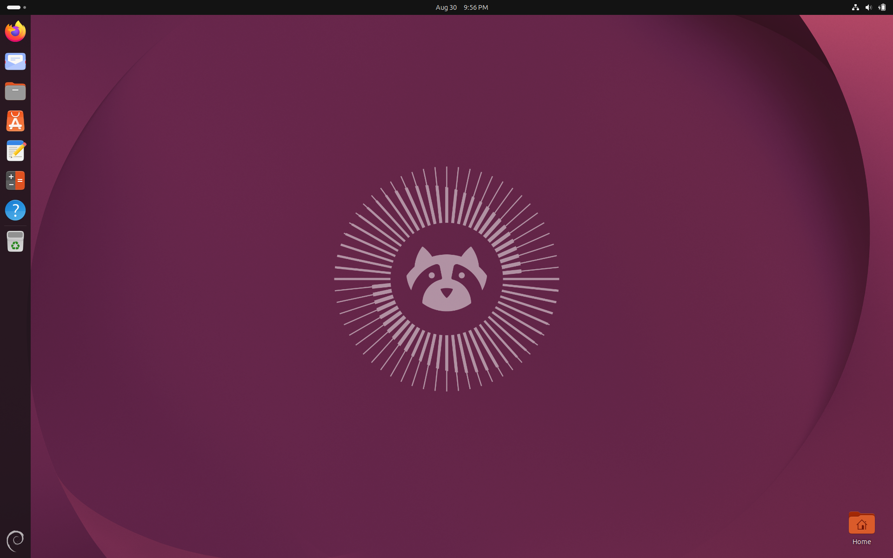
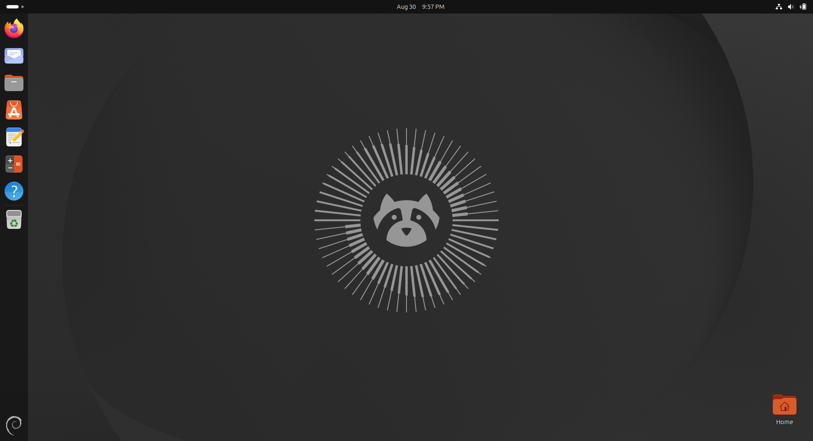
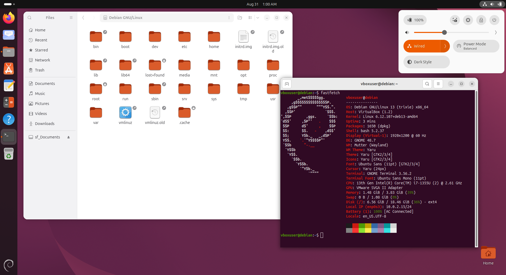
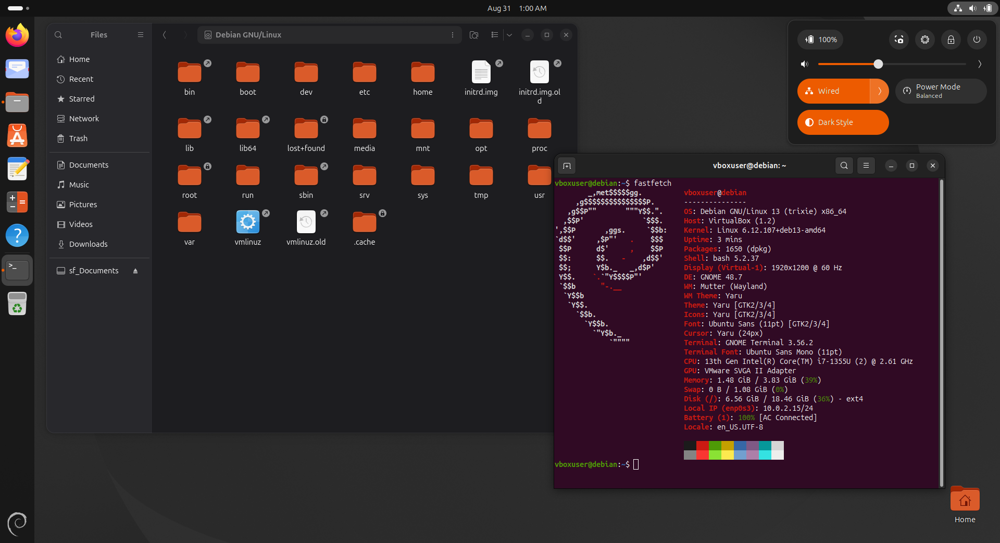

# Ubuntu Look

[English](README.md) | **Русский**

Делает Debian GNOME похожим по виду и поведению на новейший выпуск Ubuntu, который работает с вашей GNOME Shell (самим рабочим столом), не ломая Debian. Скрипт приносит темы Yaru, шрифты и обои Ubuntu, Ubuntu Dock, помощник по раскладке окон (Tiling Assistant), значки в трее, значки на рабочем столе, цвета терминала Ubuntu, экран входа в стиле Yaru, заставку загрузки Ubuntu и настройки рабочего стола Ubuntu. Как и в Ubuntu, всё это доступно как сеанс **Ubuntu** на экране входа, рядом с сеансом GNOME от Debian. Приложения не устанавливаются.

> [!WARNING]
> **Используйте на свой страх и риск.** Скрипт изменяет системные пакеты, источники apt, экран входа и параметры загрузки. Он предоставляется «как есть», без каких-либо гарантий. Авторы не несут ответственности за потерю данных, систему, которая перестала запускаться, и любой другой ущерб. Прочитайте эту страницу, сделайте резервные копии важного и решайте сами, прежде чем запускать скрипт. См. [LICENSE](LICENSE).






## Содержание

- [Быстрый старт](#быстрый-старт)
- [Требования](#требования)
- [Команды](#команды)
- [Параметры](#параметры)
- [Какой выпуск Ubuntu вы получите](#какой-выпуск-ubuntu-вы-получите)
- [Откуда берётся каждая возможность](#откуда-берётся-каждая-возможность)
- [Пакеты](#пакеты)
- [Рабочий стол](#рабочий-стол)
- [Настройки: Ubuntu и Debian](#настройки-ubuntu-и-debian)
- [Поддержание в актуальном состоянии](#поддержание-в-актуальном-состоянии)
- [Сброс](#сброс)
- [Обновление Debian](#обновление-debian)
- [Удаление](#удаление)
- [Устранение неполадок](#устранение-неполадок)
- [Как это работает](#как-это-работает)
- [Не ломайте Debian](#не-ломайте-debian)
- [Тесты](#тесты)

**Как записаны команды на этой странице:** каждая команда занимает одну строку. Часть **жирным шрифтом** — это значение, которое выбираете вы; остальное вводите как показано.

## Быстрый старт

1. Скачайте `ubuntu-look.sh` (или клонируйте этот репозиторий).
2. Откройте терминал в его папке, внутри сеанса рабочего стола, и выполните:

   ```bash
   bash ubuntu-look.sh
   ```

3. Прочитайте, что будет сделано, введите `y` и нажмите Enter, затем введите пароль, когда его запросят.
4. В конце скрипт перезагружает компьютер после 60-секундного обратного отсчёта: нажмите Enter, чтобы перезагрузиться сразу, или Ctrl-C, чтобы отменить.

Полезно знать:

- Скрипт задаёт вопросы через терминал, поэтому ответы, переданные ему по конвейеру (`yes | bash ubuntu-look.sh`), не используются; без терминала каждый вопрос считается ответом «нет».
- Повторный запуск безопасен для системы. Обычный запуск также сбрасывает ваши собственные значения настроек оформления; см. [Сброс](#сброс).
- Чтобы убрать оформление, см. [Удаление](#удаление).

## Требования

| Требование               | Подробности                                                  |
|--------------------------|--------------------------------------------------------------|
| Система                  | Debian с GNOME                                               |
| Процессор                | тип, который поддерживает Ubuntu (amd64, arm64 и другие)     |
| Пользователь             | обычная учётная запись с правами sudo; не запускайте от root |
| Сеть                     | доступ в интернет                                            |
| GNOME Shell 45 или новее | для темы оболочки Yaru, переключения стиля, экрана входа Yaru |
| GNOME Shell 47 или новее | для акцентного цвета                                         |

## Команды

<pre>
bash ubuntu-look.sh              # установить или обновить и сбросить настройки оформления
bash ubuntu-look.sh <b>--refresh</b>    # показать обновления, спросить, затем обновить и починить; ничего не сбрасывает
bash ubuntu-look.sh <b>--reset</b>      # сбросить настройки оформления установленного оформления
bash ubuntu-look.sh <b>--uninstall</b>  # убрать оформление
bash ubuntu-look.sh <b>--help</b>       # команды и параметры (также -h)
</pre>

| Команда               | Что делает                                         | Настройки оформления            | Ваши файлы  |
|-----------------------|----------------------------------------------------|---------------------------------|-------------|
| `bash ubuntu-look.sh` | устанавливает либо чинит и обновляет               | сбрасываются на значения Ubuntu | сохраняются |
| `--refresh`           | показывает обновления, спрашивает, затем обновляет | сохраняются                     | сохраняются |
| `--reset`             | чинит и обновляет                                  | сбрасываются на значения Ubuntu | сохраняются |
| `--uninstall`         | удаляет оформление                                 | сбрасываются на значения Debian | сохраняются |
| `--help`, `-h`        | выводит команды и параметры                        | сохраняются                     | сохраняются |

- Указывайте только одну из команд `--refresh`, `--reset` и `--uninstall`.
- `--refresh` и `--reset` работают только после установки оформления.
- Запускайте `--reset` и `--uninstall` из терминала внутри сеанса рабочего стола, чтобы можно было сбросить ваши настройки.
- `--uninstall` удаляет сеанс Ubuntu и всё, что установил скрипт; собственный сеанс GNOME от Debian остаётся.
- **Настройки оформления** — это те, которые задаёт оформление: обои, тема, шрифты, кнопки окон, сочетания клавиш, цвета терминала, настройки питания, а также настройки дока и других расширений, которые оно приносит. Значения, которые убирает сброс, не сохраняются. У расширения, которое у вас стоит в собственной сборке (например, Dash to Dock из Debian или с extensions.gnome.org), настройки сохраняются.
- **Ваши файлы** — это ваши файлы, папки, установленные приложения и каждая настройка, которую оформление не задаёт, например избранное, раскладки клавиатуры и настройки приложений. Ни одна команда их не меняет.

То, что скрипт удаляет в вашей домашней папке, принадлежит ему самому:

| В вашей домашней папке                     | Удаляется                                     |
|--------------------------------------------|-----------------------------------------------|
| `ubuntu-look-<команда>-<дата>-<время>.log` | все, кроме десяти новейших для каждой команды |
| те же журналы запусков                     | все, когда удаление полностью завершено       |
| `~/.config/tiling-assistant/`              | при `--uninstall`                             |
| `~/.local/share/session_migration-*`       | при `--uninstall`                             |
| `~/.local/share`, `~/.local`               | при `--uninstall`, только если они пусты      |
| `~/.ubuntu-look-backup`                    | при `--uninstall`                             |

- `~/.config/tiling-assistant/` — это раскладка окон, которую сохранил помощник раскладки окон из состава оформления.
- Маркеры `session_migration-*` существуют там, где оформление принесло `session-migration`.
- `~/.ubuntu-look-backup` — папка, оставленная версией 1.0; версия 1.1 её не создаёт.

## Параметры

Параметры — это настройки, которые указываются перед командой. Можно задать несколько сразу, разделяя их пробелами:

<pre>
<b>UBUNTU_BOOT_SPLASH=0</b> <b>UBUNTU_LOOK_ANIMATIONS=0</b> bash ubuntu-look.sh
</pre>

Недопустимое значение останавливает запуск до того, как что-либо изменится.

**Запоминаемые параметры.** Завершённая установка сохраняет эти четыре параметра, и последующие запуски используют их снова, пока вы не зададите новое значение.

| Параметр             | Задаёт                     | По умолчанию | Допустимые значения |
|----------------------|----------------------------|--------------|---------------------|
| `UBUNTU_CODENAME`    | используемый выпуск Ubuntu | `auto`       | `auto`, кодовое имя |
| `UBUNTU_MIRROR`      | сервер загрузки            | архив Ubuntu | один веб-адрес      |
| `UBUNTU_BOOT_SPLASH` | заставку загрузки          | `1`          | `0`, `1`            |
| `PLYMOUTH_THEME`     | тему заставки загрузки     | `bgrt`       | установленная тема  |

**Параметр одного запуска.** Действует только на тот запуск, которому он передан.

| Параметр                 | Задаёт           | По умолчанию | Допустимые значения |
|--------------------------|------------------|--------------|---------------------|
| `UBUNTU_LOOK_ANIMATIONS` | эффекты анимации | не задан     | `0`, `1`            |

**Не параметры.** Это зафиксировано, и ничто этого не меняет:

| Поведение            | Зафиксировано                                                 |
|----------------------|---------------------------------------------------------------|
| Выпуск Ubuntu        | только выпущенные версии, никогда не находящиеся в разработке |
| Обновления           | только собственные пакеты оформления                          |
| Журнал запуска       | пишется всегда                                                |
| Перезагрузка в конце | всегда, после 60-секундного обратного отсчёта                 |

- Остальная система остаётся на ваш собственный `apt upgrade`.
- `UBUNTU_INCLUDE_DEVEL`, `UBUNTU_LOOK_SYSTEM_UPGRADE`, `UBUNTU_LOOK_LOG` и `UBUNTU_LOOK_REBOOT` были параметрами прежних версий. Запуск, которому передан любой из них, останавливается до внесения каких-либо изменений и сообщает об этом.
- См. [Журнал запуска](#журнал-запуска) и [Перезагрузка](#перезагрузка).

### `UBUNTU_CODENAME`

Выпуск Ubuntu, с которого берётся оформление, заданный его кодовым именем.

| Значение                      | Смысл                                             |
|-------------------------------|---------------------------------------------------|
| `auto` (по умолчанию)         | новейший выпуск, подходящий для вашей GNOME Shell |
| кодовое имя в нижнем регистре | этот выпуск                                       |
| `devel`                       | отклоняется: не называет никакого выпуска         |
| выпуск в разработке           | отклоняется                                       |

- Кодовые имена, например: `noble`, `plucky`, `questing`, `resolute` и `stonking`; см. [Какой выпуск Ubuntu вы получите](#какой-выпуск-ubuntu-вы-получите). Выпуск должен быть опубликован на зеркале или в архиве старых выпусков Ubuntu (old-releases).
- Выпуск, рассчитанный на другую GNOME Shell, может не содержать док или тему оболочки; сводка сообщает об этом.
- Используются только выпущенные версии. Выпуск в разработке — это тот, на который указывает ссылка `devel` в архиве, проверенный по собственному списку выпусков Ubuntu.

<pre>
UBUNTU_CODENAME=<b>noble</b> bash ubuntu-look.sh   # использовать Ubuntu 24.04
UBUNTU_CODENAME=<b>auto</b> bash ubuntu-look.sh    # вернуться к автоматическому выбору
</pre>

### `UBUNTU_MIRROR`

Сервер, с которого загружаются пакеты Ubuntu.

| Значение                                              | Смысл                       |
|-------------------------------------------------------|-----------------------------|
| `http://archive.ubuntu.com/ubuntu` (по умолчанию)     | на amd64 и i386             |
| `http://ports.ubuntu.com/ubuntu-ports` (по умолчанию) | на других типах процессоров |
| один адрес `http://` или `https://`                   | этот сервер                 |
| адрес с именем пользователя или паролем               | отклоняется                 |

Адрес показывается в журнале запуска и хранится в файлах, которые может читать любой пользователь, поэтому имя пользователя и пароль в нём не допускаются.

<pre>
UBUNTU_MIRROR=<b>http://de.archive.ubuntu.com/ubuntu</b> bash ubuntu-look.sh
</pre>

### `UBUNTU_BOOT_SPLASH`

Заставка загрузки: логотип, который показывается при запуске компьютера. Только с GRUB.

| Значение           | Смысл                                                   | Как в  |
|--------------------|---------------------------------------------------------|--------|
| `1` (по умолчанию) | добавляет заставку                                      | Ubuntu |
| `0`                | без заставки; убирает ту, что оформление добавило ранее | Debian |

Ubuntu запускается с `quiet splash` в параметрах запуска, Debian — только с `quiet`.

<pre>
UBUNTU_BOOT_SPLASH=<b>0</b> bash ubuntu-look.sh   # без заставки загрузки
UBUNTU_BOOT_SPLASH=<b>1</b> bash ubuntu-look.sh   # заставка загрузки, как в Ubuntu
</pre>

### `PLYMOUTH_THEME`

Тема заставки загрузки.

| Значение               | Смысл                                                              |
|------------------------|--------------------------------------------------------------------|
| `bgrt` (по умолчанию)  | тема Ubuntu: логотип производителя компьютера и индикатор загрузки |
| имя установленной темы | эта тема, например `spinner`                                       |

- Чтобы вывести список установленных тем: `/usr/sbin/plymouth-set-default-theme -l`
- Имя состоит из букв, цифр и символов `.` `_` `+` `-`.
- Если указанная вами тема не установлена, об этом сообщается, а тема остаётся прежней.

<pre>
PLYMOUTH_THEME=<b>spinner</b> bash ubuntu-look.sh   # другая тема
PLYMOUTH_THEME=<b>bgrt</b> bash ubuntu-look.sh      # снова тема Ubuntu
</pre>

### `UBUNTU_LOOK_ANIMATIONS`

Эффекты анимации — только для вашего пользователя. Это тот же переключатель, что и Параметры → Универсальный доступ → Зрение → Уменьшить анимацию.

| Значение                | Смысл                             |
|-------------------------|-----------------------------------|
| не задан (по умолчанию) | анимация остаётся как есть        |
| `1`                     | включена, как в Ubuntu и в Debian |
| `0`                     | выключена                         |

- Без параметра ничего не меняется: последующие запуски и удаление сохраняют ваш выбор.
- Параметр работает с каждым запуском, включая удаление.

Один переключатель охватывает всё это:

| Анимация                                          | Где                                  |
|---------------------------------------------------|--------------------------------------|
| открытие, закрытие, сворачивание и разворачивание | окна                                 |
| переключение                                      | рабочие пространства                 |
| открытие и закрытие                               | обзор «Активности», сетка приложений |
| показ, скрытие и эффекты значков                  | Ubuntu Dock                          |
| перемещение при раскладке и возврате окон         | помощник раскладки окон              |
| переходы                                          | внутри приложений GTK                |

<pre>
UBUNTU_LOOK_ANIMATIONS=<b>0</b> bash ubuntu-look.sh               # выключить
UBUNTU_LOOK_ANIMATIONS=<b>1</b> bash ubuntu-look.sh               # включить
UBUNTU_LOOK_ANIMATIONS=<b>0</b> bash ubuntu-look.sh --uninstall   # выключить при удалении
</pre>

### Журнал запуска

Каждый запуск, изменяющий систему, записывает журнал в вашу домашнюю папку. Отключить это нельзя.

- Файл называется `ubuntu-look-<команда>-<дата>-<время>.log`, например `ubuntu-look-install-20260928-151900.log`.
- Сохраняются десять новейших для каждой команды.
- Запуск, от которого вы отказались, или отклонённый до внесения изменений, журнала не оставляет. Полное удаление убирает их все.

### Перезагрузка

Запуск, изменивший систему, в конце перезагружает компьютер после 60-секундного обратного отсчёта. Отключить это нельзя.

| Ситуация                                   | Что происходит                       |
|--------------------------------------------|--------------------------------------|
| запуск изменил систему, ничего не осталось | обратный отсчёт, затем перезагрузка  |
| Enter во время обратного отсчёта           | перезагрузка сразу                   |
| Ctrl-C во время обратного отсчёта          | перезагрузка отменяется              |
| терминал закрыт во время обратного отсчёта | перезагрузки нет                     |
| запуск ничего не изменил                   | перезагрузки нет; называется команда |
| какой-то шаг не удалось завершить          | перезагрузки нет                     |
| нет терминала                              | ни обратного отсчёта, ни перезагрузки |

Запуск, который ничего не изменил, не ведёт обратный отсчёт, даже если за более ранним запуском ещё числится перезагрузка. Выполните `sudo reboot`, когда будете готовы.

## Какой выпуск Ubuntu вы получите

Скрипт использует новейший выпущенный Ubuntu, оформление которого устанавливается на собственную GNOME Shell вашего Debian. Он определяет это при каждом запуске, имитируя установку темы оболочки Yaru и дока каждого выпуска, начиная с новейшего. GNOME Shell от Debian никогда не заменяется, поэтому предел задаёт её версия.

В таблицах показано состояние обоих архивов на 14 ноября 2026 года.

Debian:

| Набор   | Выпуск       | GNOME Shell |
|---------|--------------|-------------|
| stable  | trixie, 13.7 | 48.7        |
| testing | forky        | 51.0        |

Ubuntu («Shell» — это GNOME Shell):

| Выпуск             | Статус                     | Shell | Тема требует Shell | Расширения требуют Shell |
|--------------------|----------------------------|-------|--------------------|--------------------------|
| 25.04 plucky       | выпущен, не поддерживается | 48.0  | 48 или новее       | 48                       |
| 25.10 questing     | выпущен, не поддерживается | 49.0  | 49 или новее       | 48 или 49                |
| 26.04 LTS resolute | выпущен, поддерживается    | 50.1  | 49 или новее       | 49 или 50                |
| 26.10 stonking     | выпущен, новейший          | 51.0  | 49 или новее       | 50 или 51                |
| 27.04 tenacious    | в разработке               | 51.0  | 49 или новее       | 50 или 51                |

«Не поддерживается» означает, что выпуск больше не поддерживается Ubuntu. «Тема» — это тема оболочки Yaru.

Что вы получите:

| Debian             | GNOME Shell | Используемый выпуск Ubuntu |
|--------------------|-------------|----------------------------|
| 13 trixie (stable) | 48.7        | 25.04 plucky               |
| forky (testing)    | 51.0        | 26.10 stonking             |

- **Debian 13:** начиная с 25.10 пакет темы оболочки Yaru конфликтует с GNOME Shell ниже 49, поэтому apt не может его установить. Срок поддержки Ubuntu 25.04 истёк, поэтому пакеты его оформления больше не получают обновлений от Ubuntu. Это остаётся новейший выпуск, который может принять GNOME Shell из Debian 13.
- **forky:** 26.10 — новейший выпущенный Ubuntu; его тема и расширения принимают GNOME Shell 51.
- Выпуск в разработке никогда не используется.

## Откуда берётся каждая возможность

Цель — настоящие внешний вид, стиль и поведение Ubuntu, взятые из самого выпуска Ubuntu, на Debian, который остаётся Debian.

### Из настоящего Ubuntu

«Читается» означает, что скрипт скачивает этот пакет Ubuntu, читает его и не устанавливает.

| Возможность                                  | Берётся из пакетов Ubuntu                  | Как             |
|----------------------------------------------|--------------------------------------------|-----------------|
| Какой выпуск Ubuntu используется             | тема оболочки Yaru и док каждого выпуска   | имитация        |
| Тема GTK, значки, курсор, звуки              | пакеты Yaru                                | устанавливается |
| Тема GNOME Shell                             | пакет темы оболочки Yaru                   | устанавливается |
| Шрифты Ubuntu                                | пакет шрифтов                              | устанавливается |
| Обои                                         | пакеты обоев                               | устанавливается |
| Имена файлов обоев                           | `ubuntu-settings`                          | читается        |
| Ubuntu Dock, помощник раскладки окон         | пакеты расширений                          | устанавливается |
| Значки в трее, значки на рабочем столе       | пакеты расширений                          | устанавливается |
| Поставщик веб-поиска                         | пакеты расширений                          | устанавливается |
| Прочие пакеты оформления рабочего стола      | `ubuntu-desktop-minimal`, `ubuntu-session` | устанавливается |
| Настройки рабочего стола                     | `ubuntu-settings`                          | читается        |
| Новые значения по умолчанию позднего выпуска | `ubuntu-settings`                          | читается        |
| Светлый или тёмный стиль                     | `gnome-shell-common`, `ubuntu-settings`    | читается        |
| Тема и шрифты экрана входа                   | `ubuntu-settings`                          | читается        |
| Название и комментарий сеанса                | `ubuntu-session`                           | читается        |
| Режим сеанса                                 | `gnome-shell-common`                       | читается        |
| Цвета терминала                              | установленная тема Yaru                    | читается        |
| Сочетание клавиш для терминала               | `gnome-settings-daemon-common`             | читается        |
| Сглаживание шрифтов                          | `fontconfig-config`                        | читается        |

- **Какой выпуск:** каждый выпуск пробуется с новейшего с помощью имитации установки.
- **Расширения** приходят со своими настройками по умолчанию.
- **Прочие пакеты оформления** — это новый пакет темы, шрифта или расширения из рабочего стола Ubuntu. Они устанавливаются, если имитация apt проходит чисто.
- **Настройки рабочего стола** — это шрифты, кнопки окон, сочетания клавиш, питание, тачпад и остальное.
- **Новые значения по умолчанию** применяются там, где в этом Debian есть соответствующее программное обеспечение.
- **Режим сеанса** — это таблица стилей, тема, стиль и запускаемые расширения.
- **Цвета терминала** читаются из правила темы Yaru для терминала.
- **Сглаживание шрифтов** использует стандартные файлы fontconfig, которые включает Ubuntu; используются собственные копии Debian.

### Не из Ubuntu — по выбору

| Возможность                       | Что вы получаете вместо этого | Причина                                        |
|-----------------------------------|-------------------------------|------------------------------------------------|
| Логотип Ubuntu                    | логотип Debian или ничего     | намеренно опущен                               |
| Заставка загрузки                 | собственный Plymouth Debian   | загрузка остаётся загрузкой Debian             |
| Скрытое меню загрузки             | меню показывается             | при неудачной загрузке меню остаётся доступным |
| Службы Canonical                  | не применяются                | не часть оформления                            |
| Расширения с `@canonical.com`     | не запускаются                | им нужно программное обеспечение Canonical     |
| Избранное в доке                  | ваше сохраняется              | приложений Ubuntu нет в Debian                 |
| Собственный сеанс GNOME от Debian | без изменений                 | у оформления свой сеанс                        |
| Сеанс нового пользователя         | сеанс GNOME от Debian         | как в Ubuntu                                   |

- **Логотип Ubuntu** отображался бы на экране входа, на кнопке «Показать приложения» и на клавише Super экранной клавиатуры.
- **Заставка загрузки:** используется Plymouth из Debian с темой того же рода, что и в Ubuntu.
- **Меню загрузки:** Ubuntu его скрывает; на Debian из-за этого неудачная загрузка могла бы остаться без меню.
- **Службы Canonical** — это поисковые настройки по умолчанию в вебе, партнёрский Firefox, сервер ключей и уведомление об обновлениях.
- **Расширения `@canonical.com`** — это расширения snapd и другие.
- **Сеанс GNOME от Debian** сохраняет значения по умолчанию Debian. Пакет настроек Ubuntu только читается, но не устанавливается: будучи установленным, он изменил бы и сеанс Debian.
- **Новые пользователи** начинают в сеансе GNOME от Debian, как в Ubuntu, когда установлен собственный сеанс GNOME; сеанс Ubuntu они выбирают один раз на экране входа.

### Не из Ubuntu — потому что иначе нельзя

| Возможность                                                | Что вы получаете вместо этого                  |
|------------------------------------------------------------|------------------------------------------------|
| Значки оболочки Yaru                                       | небольшое расширение, написанное скриптом      |
| Переключатель тёмного стиля, акцентные цвета               | то же расширение                               |
| Оформление экрана входа                                    | расширение экрана входа от скрипта             |
| То, благодаря чему работает сочетание клавиш для терминала | обычное пользовательское сочетание             |
| Список компонентов сеанса                                  | собственный сеанс GNOME от Debian              |
| Запись сеанса, файлы режима сеанса                         | пишутся скриптом                               |
| Хук apt                                                    | пишется скриптом                               |

- **Значки оболочки, переключатель стиля, акценты, экран входа:** в Ubuntu всё это находится внутри её пропатченной GNOME Shell, которая заменила бы GNOME Shell из Debian. Расширение скрипта использует настоящие файлы Yaru.
- **Сочетание клавиш для терминала:** эту клавишу обрабатывает пропатченный демон настроек Ubuntu; у Debian такой клавиши нет.
- **Список компонентов:** он должен соответствовать демону настроек Debian. Список Ubuntu отличается и мог бы помешать запуску сеанса.
- **Файлы сеанса:** пакет `ubuntu-session` из Ubuntu требует точной сборки `gnome-session` от Ubuntu, поэтому его нельзя установить. Файлы пишутся из записей Debian и значений Ubuntu.
- **Хук apt:** он не из Ubuntu. Он убирает сеанс Ubuntu с экрана входа при смене GNOME Shell, так что вход в Debian всегда возможен.

### Отсутствует

| Возможность                                              | Является частью                              |
|----------------------------------------------------------|----------------------------------------------|
| Страница «Ubuntu Desktop» в Параметрах                   | пропатченного приложения «Параметры» Ubuntu  |
| Точные оттенки акцентных цветов Yaru, местами            | пропатченных libadwaita и GNOME Shell Ubuntu |
| Прозрачность терминала                                   | пропатченного Терминала Ubuntu               |
| Возврат назад клавишей Backspace в «Файлах»              | пропатченных «Файлов» Ubuntu                 |
| Меню дока для Rhythmbox и «Видео»                        | пропатченных сборок этих приложений Ubuntu   |
| Сворачивание Rhythmbox вместо выхода при воспроизведении | пропатченного Rhythmbox Ubuntu               |
| Название «Просмотр изображений» для eog                  | пропатченного eog Ubuntu                     |
| Snap Store и приложения snap                             | snapd и магазина Canonical                   |

- Вместо страницы Ubuntu Desktop у дока есть собственное окно настроек; см. [Ubuntu Dock](#ubuntu-dock).
- Приложения остаются в сборках Debian. Браузеры и почтовые программы сами следуют теме Yaru, как в Ubuntu.

## Пакеты

| Пакет                                           | Назначение                        | Откуда |
|-------------------------------------------------|-----------------------------------|--------|
| `yaru-theme-gtk`                                | тема Yaru для приложений          | Ubuntu |
| `yaru-theme-icon`                               | значки Yaru                       | Ubuntu |
| `yaru-theme-sound`                              | звуки Yaru                        | Ubuntu |
| `yaru-theme-gnome-shell`                        | тема оболочки рабочего стола Yaru | Ubuntu |
| `fonts-ubuntu`                                  | шрифты Ubuntu                     | Ubuntu |
| `ubuntu-wallpapers`, набор самого выпуска       | обои                              | Ubuntu |
| `gnome-shell-extension-ubuntu-dock`             | Ubuntu Dock                       | Ubuntu |
| `gnome-shell-extension-ubuntu-tiling-assistant` | раскладка окон                    | Ubuntu |
| `session-migration`                             | требуется Yaru                    | Ubuntu |
| `libreoffice-style-yaru`                        | стиль LibreOffice                 | Ubuntu |
| `gnome-shell-extension-appindicator`            | значки в трее на верхней панели   | Debian |
| `gnome-shell-extension-desktop-icons-ng`        | файлы на рабочем столе            | Debian |
| `rhythmbox-plugin-alternative-toolbar`          | панель инструментов Rhythmbox     | Debian |
| `gnome-session-canberra`                        | звук экрана входа                 | Debian |
| `plymouth`, `plymouth-themes`                   | заставка загрузки                 | Debian |
| `dconf-cli`                                     | инструмент настроек               | Debian |
| `ubuntu-keyring`                                | ключи подписи Ubuntu              | Debian |
| `curl`, `ca-certificates`                       | средства загрузки                 | Debian |

- `libreoffice-style-yaru` устанавливается только при установленном LibreOffice, а `rhythmbox-plugin-alternative-toolbar` — только при установленном Rhythmbox. После установки любого из этих приложений запустите скрипт снова, чтобы получить его стиль Ubuntu.
- `plymouth` и `plymouth-themes` не устанавливаются при `UBUNTU_BOOT_SPLASH=0`.
- `curl` и `ca-certificates` устанавливаются, если их нет. Удаление их сохраняет.
- `session-migration` содержит скомпилированную программу; скрипт держит её пользовательскую службу выключенной.
- `gnome-session-canberra` проигрывает звук Yaru, когда экран входа готов. Звук при входе выключен, как в Ubuntu.
- `ubuntu-keyring` — это то, чем apt проверяет пакеты Ubuntu.
- В некоторых выпусках Ubuntu Ubuntu Dock, помощник раскладки окон, значки в трее и значки на рабочем столе поставляются одним пакетом, `gnome-shell-ubuntu-extensions`. Когда выбранный выпуск его содержит, скрипт устанавливает его вместо четырёх отдельных пакетов. Если пакет несёт расширение поставщика веб-поиска Ubuntu, оно тоже работает, как в Ubuntu. При удалении возвращаются пакеты Debian, которые он заменил.

## Рабочий стол

Запускайте скрипт из сеанса рабочего стола. Он добавляет сеанс **Ubuntu** для всех пользователей и выбирает его для вас. Оформление Ubuntu появляется только в сеансе Ubuntu; сеанс GNOME от Debian сохраняет значения по умолчанию Debian. Настройки, которые вы делаете сами, действуют в обоих сеансах, как в Ubuntu. Экран входа и заставка загрузки общие для всех пользователей.

- **Сеанс:** экран входа предлагает Ubuntu и Ubuntu на Xorg рядом с GNOME и GNOME на Xorg. Ubuntu — это сеанс Wayland на собственных GNOME Shell и Mutter от Debian. Чтобы переключиться, выберите своё имя, затем кнопку с шестерёнкой, затем Ubuntu или GNOME; экран входа запоминает выбор. Обычный запуск и `--reset` выбирают Ubuntu за вас и оставляют Ubuntu на Xorg, если вы выбрали его; `--refresh` сохраняет то, что вы выбрали, включая GNOME.
- **Настройки:** настройки рабочего стола Ubuntu как значения по умолчанию сеанса Ubuntu для всех пользователей. Значения, которые вы задали сами, имеют приоритет над значениями Ubuntu, как в Ubuntu, до следующего [сброса](#сброс); после `--refresh` сводка перечисляет их.
- **Тема оболочки и расширения:** GNOME Shell запускается в режиме сеанса Ubuntu, `ubuntu`, как в Ubuntu. Режим загружает Yaru и запускает док, значки в трее, значки на рабочем столе и помощник раскладки окон до того, как что-либо нарисовано, поэтому панель, док и значки на рабочем столе не смещаются после входа. Как и в Ubuntu, док оформляет один лишь Yaru. Чтобы отключить одно из этих расширений, используйте приложение «Расширения».
- **Док:** как в Ubuntu, если у вас включён Dash-to-Dock, Ubuntu Dock уступает ему место. Выключите Dash-to-Dock в приложении «Расширения», чтобы увидеть Ubuntu Dock.
- **Кнопка «Показать приложения»:** показывает логотип Debian в Ubuntu Dock.
- **Значки оболочки:** верхняя панель и меню используют собственные символические значки Yaru, как в Ubuntu.
- **Акцентный цвет:** как в Ubuntu, выбор акцентного цвета в Параметрах переключает тему и значки на соответствующий цвет Yaru.
- **Терминал:** профиль gnome-terminal по умолчанию получает фон Yaru #300A24 и белый текст со стандартными цветами GNOME, как в Ubuntu. Gnome-terminal в Ubuntu берёт их из Yaru; у Debian это не получается, поэтому они задаются в профиле. Остальные ваши профили остаются как есть.
- **Ctrl+Alt+T:** открывает терминал, как в Ubuntu. Если у вас есть собственные пользовательские сочетания клавиш, оно добавляется к ним, если только Ctrl+Alt+T уже не занято другим. Ваш список сочетаний общий с сеансом GNOME от Debian, поэтому там сочетание отображается в Параметрах и тоже работает. Если вы его удалите, `--refresh` оставит его удалённым; обычный запуск или `--reset` добавят его снова.
- **Сглаживание шрифтов:** субпиксельное во всех приложениях внутри сеанса Ubuntu, через те же стандартные файлы fontconfig, которые включает Ubuntu.
- **Экран входа:** тема и звуки Yaru, шрифты и обои Ubuntu.
- **Напоминание о пожертвованиях:** выключено там, где используемый выпуск Ubuntu его выключает (Ubuntu 26.10 выключает), как в Ubuntu.
- **Загрузка (только с GRUB):** `quiet splash` добавляется в параметры запуска в `/etc/default/grub`, если их там нет, и задаётся тема заставки загрузки. Другие настройки GRUB не затрагиваются. Если параметры запуска задаёт файл в `/etc/default/grub.d/`, файл `/etc/default/grub` не трогается, и сводка сообщает об этом. Без GRUB загрузка остаётся как есть.

## Настройки: Ubuntu и Debian

В каждой таблице приведены значение Ubuntu (оформление) и значение Debian. Под ней — команды, которые меняют эти настройки, каждая с допустимыми значениями. Значения Ubuntu — это значения Ubuntu 25.04; при каждом запуске они берутся из используемого выпуска Ubuntu, поэтому меняются там, где их меняет более поздний выпуск.

Большинство настроек есть и в Параметрах GNOME. Ваши настройки действуют в обоих сеансах. Чтобы вернуть настройке значение Ubuntu (значение Debian — в сеансе GNOME), используйте `gsettings reset` с теми же двумя именами:

<pre>
gsettings reset <b>org.gnome.settings-daemon.plugins.power</b> <b>power-button-action</b>
</pre>

### Клавиатура и окна

| Настройка                                | Ubuntu (оформление)           | Debian                 |
|------------------------------------------|-------------------------------|------------------------|
| Alt+Tab                                  | переключает окна              | переключает приложения |
| Super+Tab                                | переключает приложения        | переключает приложения |
| Super+D, Ctrl+Super+D, Ctrl+Alt+D        | показывают рабочий стол       | ничего                 |
| Ctrl+Alt+T                               | открывает терминал            | ничего                 |
| Кнопки окна                              | свернуть, развернуть, закрыть | только закрыть         |
| Щелчок средней кнопкой по заголовку окна | `lower`: опускает окно        | `none`                 |
| Активный угол (левый верхний)            | `false`: выключен             | `true`: включён        |

<pre>
# Alt+Tab переключает приложения, как в Debian (все четыре строки)
gsettings set org.gnome.desktop.wm.keybindings switch-windows <b>"[]"</b>
gsettings set org.gnome.desktop.wm.keybindings switch-windows-backward <b>"[]"</b>
gsettings set org.gnome.desktop.wm.keybindings switch-applications <b>"['&lt;Super&gt;Tab', '&lt;Alt&gt;Tab']"</b>
gsettings set org.gnome.desktop.wm.keybindings switch-applications-backward <b>"['&lt;Shift&gt;&lt;Super&gt;Tab', '&lt;Shift&gt;&lt;Alt&gt;Tab']"</b>

# кнопки окна: minimize, maximize, close в любом порядке; до «:» — левая сторона
# Ubuntu ':minimize,maximize,close'   Debian 'appmenu:close'
gsettings set org.gnome.desktop.wm.preferences button-layout <b>'close,minimize,maximize:'</b>

# щелчок средней кнопкой по заголовку окна: none, lower, minimize, menu, toggle-maximize,
# toggle-maximize-horizontally, toggle-maximize-vertically
gsettings set org.gnome.desktop.wm.preferences action-middle-click-titlebar <b>none</b>

# активный угол: true, false
gsettings set org.gnome.desktop.interface enable-hot-corners <b>true</b>
</pre>

Ctrl+Alt+T меняется в Параметры → Клавиатура → Просмотр и настройка сочетаний клавиш → Свои сочетания клавиш.

### Питание, блокировка и сеанс

Оформление задаёт первые две строки и последние две. Остальные — это параметры питания, которые есть в Ubuntu; для них Ubuntu и Debian поставляют одно и то же значение, и ни одна команда скрипта их не меняет.

| Настройка                                        | Ubuntu (оформление)                   | Debian                                |
|--------------------------------------------------|---------------------------------------|---------------------------------------|
| Кнопка питания                                   | `interactive`: спрашивает, что делать | `suspend`                             |
| Сон при питании от сети, через                   | `0`: никогда                          | `900`: 15 минут простоя               |
| Сон при питании от сети, действие                | `suspend`                             | `suspend`                             |
| Сон при питании от батареи, через                | `900`: 15 минут простоя               | `900`: 15 минут простоя               |
| Сон при питании от батареи, действие             | `suspend`                             | `suspend`                             |
| Гашение экрана, через                            | `300`: 5 минут простоя                | `300`: 5 минут простоя                |
| Затемнять экран при простое                      | `true`: вкл.                          | `true`: вкл.                          |
| Автоматическая блокировка экрана                 | `true`: вкл.                          | `true`: вкл.                          |
| Задержка блокировки после гашения                | `0`: сразу                            | `0`: сразу                            |
| Уведомления на экране блокировки                 | `true`: показываются                  | `true`: показываются                  |
| Режим энергосбережения при низком заряде батареи | `true`: вкл.                          | `true`: вкл.                          |
| Процент заряда батареи на верхней панели         | `false`: скрыт                        | `false`: скрыт                        |
| Режим питания                                    | `balanced`                            | `balanced`                            |
| Закрытие крышки, от батареи                      | `suspend`                             | `suspend`                             |
| Закрытие крышки, от сети                         | `suspend`                             | `suspend`                             |
| Закрытие крышки, в док-станции                   | `ignore`                              | `ignore`                              |
| «Завершить сеанс» в системном меню               | `true`: показывается всегда           | `false`: при нескольких пользователях |
| Начало сеанса                                    | на рабочем столе                      | в обзоре «Активности»                 |

Кнопка питания и сон:

<pre>
# кнопка питания: interactive, suspend, hibernate, nothing
gsettings set org.gnome.settings-daemon.plugins.power power-button-action <b>suspend</b>

# сон при питании от сети, через: число секунд простоя; 0 = никогда
gsettings set org.gnome.settings-daemon.plugins.power sleep-inactive-ac-timeout <b>900</b>

# сон при питании от сети, действие: suspend, hibernate, shutdown, logout, blank, interactive, nothing
gsettings set org.gnome.settings-daemon.plugins.power sleep-inactive-ac-type <b>nothing</b>

# сон при питании от батареи, через: число секунд простоя; 0 = никогда
gsettings set org.gnome.settings-daemon.plugins.power sleep-inactive-battery-timeout <b>1800</b>

# сон при питании от батареи, действие: suspend, hibernate, shutdown, logout, blank, interactive, nothing
gsettings set org.gnome.settings-daemon.plugins.power sleep-inactive-battery-type <b>hibernate</b>

# перейти в ждущий режим сейчас
systemctl suspend
</pre>

Экран и блокировка:

<pre>
# гашение экрана, через: число секунд простоя; 0 = никогда
gsettings set org.gnome.desktop.session idle-delay <b>600</b>

# затемнять экран при простое: true, false
gsettings set org.gnome.settings-daemon.plugins.power idle-dim <b>false</b>

# автоматическая блокировка экрана: true, false
gsettings set org.gnome.desktop.screensaver lock-enabled <b>false</b>

# задержка блокировки после гашения экрана: число секунд; 0 = сразу
gsettings set org.gnome.desktop.screensaver lock-delay <b>30</b>

# уведомления на экране блокировки: true, false
gsettings set org.gnome.desktop.notifications show-in-lock-screen <b>false</b>

# заблокировать экран сейчас (также Super+L)
loginctl lock-session
</pre>

Батарея и режим питания:

<pre>
# режим энергосбережения при низком заряде батареи: true, false
gsettings set org.gnome.settings-daemon.plugins.power power-saver-profile-on-low-battery <b>false</b>

# процент заряда батареи на верхней панели: true, false
gsettings set org.gnome.desktop.interface show-battery-percentage <b>true</b>

# режим питания: performance, balanced, power-saver (в той мере, в какой их поддерживает компьютер)
powerprofilesctl set <b>power-saver</b>
</pre>

Закрытие крышки. В GNOME для этого нет настройки; решает служба входа systemd — и в Ubuntu, и в Debian одинаково. Обычные значения: `suspend`, `hibernate`, `lock`, `poweroff` и `ignore`. Запишите файл, затем перезагрузитесь:

<pre>
sudo mkdir -p /etc/systemd/logind.conf.d
printf '[Login]\nHandleLidSwitch=<b>ignore</b>\nHandleLidSwitchExternalPower=<b>ignore</b>\nHandleLidSwitchDocked=<b>ignore</b>\n' | sudo tee /etc/systemd/logind.conf.d/lid.conf
</pre>

Чтобы отменить, удалите файл и перезагрузитесь:

```bash
sudo rm /etc/systemd/logind.conf.d/lid.conf
```

Сеанс:

<pre>
# «Завершить сеанс» в системном меню: true, false
gsettings set org.gnome.shell always-show-log-out <b>false</b>
</pre>

- Те же настройки есть в Параметры → Питание и в Параметры → Конфиденциальность и безопасность → Блокировка экрана.
- `HandleLidSwitch` — это крышка при питании от батареи, `HandleLidSwitchExternalPower` — при питании от сети, `HandleLidSwitchDocked` — в док-станции или при втором экране.
- Для режима питания нужен `power-profiles-daemon`.
- Сеанс начинается на рабочем столе только с выпуском Ubuntu, который это задаёт (с 26.10).

### Тачпад и звук

| Настройка        | Ubuntu (оформление)                | Debian                    |
|------------------|------------------------------------|---------------------------|
| Нажатие касанием | `true`: вкл.                       | `true`: вкл.              |
| Правый щелчок    | `default`: как поддерживает тачпад | `fingers`: двумя пальцами |
| Звуковая тема    | `Yaru`                             | `freedesktop`             |
| Звуки при вводе  | `true`: вкл.                       | `false`: выкл.            |
| Звук при входе   | нет                                | нет                       |

<pre>
# нажатие касанием: true, false
gsettings set org.gnome.desktop.peripherals.touchpad tap-to-click <b>false</b>

# правый щелчок: default, fingers, areas, none
gsettings set org.gnome.desktop.peripherals.touchpad click-method <b>fingers</b>

# звуковая тема: имя установленной звуковой темы
gsettings set org.gnome.desktop.sound theme-name <b>freedesktop</b>

# звуки при вводе: true, false
gsettings set org.gnome.desktop.sound input-feedback-sounds <b>false</b>
</pre>

- Правый щелчок `default` выполняется по области или двумя пальцами, в зависимости от возможностей тачпада.
- Нажатие касанием выключено в более старых версиях GNOME у Debian.

### Внешний вид

| Настройка               | Ubuntu (оформление)                | Debian                              |
|-------------------------|------------------------------------|-------------------------------------|
| Стиль                   | светлый                            | светлый                             |
| Акцентный цвет          | `orange`                           | `blue`                              |
| Тема, значки и курсор   | Yaru                               | Adwaita                             |
| Шрифт интерфейса        | `Ubuntu Sans 11`                   | `Adwaita Sans 11`                   |
| Шрифт документов        | `Sans 11`                          | `Adwaita Sans 11`                   |
| Моноширинный шрифт      | `Ubuntu Sans Mono 13`              | `Adwaita Mono 11`                   |
| Шрифт заголовка окна    | `Ubuntu Sans Bold 11`              | шрифт интерфейса                    |
| Сглаживание шрифтов     | субпиксельное, для всех приложений | полутоновое                         |
| Стиль терминала         | `dark`                             | `system`: следует за рабочим столом |
| Цвета терминала         | белый на #300A24                   | цвета стиля рабочего стола          |
| Значки на рабочем столе | показываются                       | нет                                 |
| Док                     | Ubuntu Dock                        | нет                                 |

<pre>
# стиль: default (светлый), prefer-dark
gsettings set org.gnome.desktop.interface color-scheme <b>prefer-dark</b>

# акцентный цвет (GNOME 47 и новее): blue, teal, green, yellow, orange, red, pink, purple, slate
gsettings set org.gnome.desktop.interface accent-color <b>purple</b>

# шрифты: имя и размер установленного шрифта
gsettings set org.gnome.desktop.interface font-name <b>'Adwaita Sans 11'</b>
gsettings set org.gnome.desktop.interface document-font-name <b>'Adwaita Sans 11'</b>
gsettings set org.gnome.desktop.interface monospace-font-name <b>'Adwaita Mono 11'</b>
gsettings set org.gnome.desktop.wm.preferences titlebar-font <b>'Adwaita Sans Bold 11'</b>

# стиль терминала: system, light, dark
gsettings set org.gnome.Terminal.Legacy.Settings theme-variant <b>system</b>
</pre>

- **Тема, значки и курсор** следуют за стилем и акцентным цветом.
- **Шрифты Debian** до GNOME 48 — `Cantarell 11` и `Monospace 11`.
- **Моноширинный шрифт:** размер 11 с GNOME 49 и новее, как в Ubuntu 25.10 и новее.
- **Сглаживание шрифтов** задаётся сеансом, а не одним переключателем.
- **Цвета терминала** меняются в Терминал → Параметры → профиль → Цвета.
- **Значки на рабочем столе** начинаются с правого нижнего угла, без корзины и дисков. Чтобы изменить это, щёлкните правой кнопкой по рабочему столу → Параметры значков рабочего стола.
- **Док:** вместо него у Debian панель избранного в обзоре «Активности».

### Ubuntu Dock

У Debian нет дока, поэтому в таблице указано только значение Ubuntu.

| Настройка                 | Ubuntu (оформление) |
|---------------------------|---------------------|
| Положение                 | `LEFT`              |
| Во всю высоту             | `true`              |
| Всегда показан            | `true`              |
| Наибольший размер значков | `48`                |

<pre>
# положение: LEFT, RIGHT, BOTTOM, TOP
gsettings set org.gnome.shell.extensions.dash-to-dock dock-position <b>BOTTOM</b>

# во всю высоту: true; false центрирует док
gsettings set org.gnome.shell.extensions.dash-to-dock extend-height <b>false</b>

# всегда показан: true; false скрывает его
gsettings set org.gnome.shell.extensions.dash-to-dock dock-fixed <b>false</b>

# наибольший размер значков: число пикселей
gsettings set org.gnome.shell.extensions.dash-to-dock dash-max-icon-size <b>32</b>
</pre>

Все остальные настройки дока находятся в его собственном окне настроек:

```bash
gnome-extensions prefs ubuntu-dock@ubuntu.com
```

### Файлы и файловые диалоги

| Настройка                                  | Ubuntu (оформление)  | Debian                    |
|--------------------------------------------|----------------------|---------------------------|
| Размер значков в «Файлах»                  | `small`              | `medium`                  |
| Открывать папку при перетаскивании над ней | `false`: выкл.       | `true`: вкл.              |
| Папки первыми в файловых диалогах GTK 3    | `true`: вкл.         | `false`: выкл.            |
| Файловые диалоги GTK 3 открываются в       | `cwd`: текущей папке | `recent`: недавних файлах |

<pre>
# размер значков в «Файлах»: small, small-plus, medium, large, extra-large
gsettings set org.gnome.nautilus.icon-view default-zoom-level <b>medium</b>

# открывать папку при перетаскивании над ней: true, false
gsettings set org.gnome.nautilus.preferences open-folder-on-dnd-hover <b>true</b>

# папки первыми в файловых диалогах GTK 3: true, false
gsettings set org.gtk.Settings.FileChooser sort-directories-first <b>false</b>

# файловые диалоги GTK 3 открываются в: cwd, recent
gsettings set org.gtk.Settings.FileChooser startup-mode <b>recent</b>
</pre>

### Приложения

Эти настройки применяются, как только вы установите приложение.

| Приложение                 | Ubuntu (оформление)                                | Debian                         |
|----------------------------|----------------------------------------------------|--------------------------------|
| LibreOffice                | значки Yaru в акцентном цвете                      | собственные значки LibreOffice |
| Просмотр изображений (eog) | боковая панель скрыта                              | боковая панель показана        |
| Rhythmbox                  | следит за музыкальной библиотекой                  | не следит                      |
| Rhythmbox                  | использует альтернативную панель инструментов      | не использует                  |
| Экранная клавиатура Onboard | тема Nightshade, закреплена, поверх остальных окон | тема Classic, плавающая        |
| Экранная клавиатура Onboard | подписи шрифтом Ubuntu Sans                        | собственные                    |
| «Программы» (Software)     | без принудительного обновления при первом запуске  | принудительное                 |

Обновление в «Программах» — это обновление его метаданных.

## Поддержание в актуальном состоянии

| Как                             | Сначала показывает обновления | Ваши настройки |
|---------------------------------|-------------------------------|----------------|
| ваш обычный `apt upgrade`       | как это делает apt            | сохраняются    |
| `bash ubuntu-look.sh --refresh` | да, затем спрашивает          | сохраняются    |
| `bash ubuntu-look.sh`           | нет                           | сбрасываются   |

- `apt upgrade` приносит обновления в рамках выбранного выпуска Ubuntu.
- `--refresh` перед внесением изменений перечисляет:
  - более новый выпуск Ubuntu либо изменение Debian или GNOME Shell, которые могут перевести оформление на другой выпуск (проверяется при применении);
  - более новые сборки пакетов оформления и те из них, которых не хватает;
  - пакеты оформления, которые больше не поддерживают вашу GNOME Shell;
  - заданный сейчас параметр, отличающийся от запомненного.
- С вашего согласия `--refresh` применяет обновления и заново записывает системные файлы оформления там, где они отличаются, в том числе когда обновлений нет, то есть он ещё и чинит оформление. Без вашего согласия он не меняет ничего, кроме списков пакетов apt, и завершается со статусом 1, как и любой отклонённый запрос.
- Обычный запуск применяет те же обновления и сбрасывает ваши настройки на значения оформления по умолчанию; см. [Сброс](#сброс).
- В фоне ничего не запускается: обновления проверяются только тогда, когда вы запускаете скрипт.

## Сброс

<pre>
bash ubuntu-look.sh            # установить или обновить, затем сбросить
bash ubuntu-look.sh <b>--reset</b>    # сбросить установленное оформление
</pre>

Каждый обычный запуск, включая первую установку, возвращает оформление в то состояние, в каком оно было после первой установки. `--reset` делает то же для уже установленного оформления; после незавершённой установки он отказывается и называет обычный запуск. Оба сообщают, что собираются сделать, и спрашивают разрешения.

> [!IMPORTANT]
> Значения, которые у вас были, не сохраняются. Запишите те, которые хотите вернуть, прежде чем запускать.

- **Для вас:** ваши собственные значения настроек оформления сбрасываются, так что сеанс Ubuntu показывает значения Ubuntu по умолчанию: темы, шрифты, обои, кнопки окон, сочетания клавиш, цвета терминала, настройки питания, а также настройки дока и других расширений, которые принесло оформление. Расширения оформления, которые вы выключили, включаются снова, сеанс Ubuntu выбирается для вашего следующего входа, а Ctrl+Alt+T снова добавляется в ваши сочетания клавиш, если вы его удалили. Светлый или тёмный стиль возвращается к тому, в котором стартует сам выпуск Ubuntu (см. [Как это работает](#как-это-работает)). Это ваши настройки и в сеансе GNOME от Debian, который затем показывает для них значения Debian по умолчанию.
- **Для всех:** сеанс, экран входа, закрепление apt (pin) и заставка загрузки записываются заново там, где они отличаются. Ваши собственные обои сбрасываются только там, где у оформления есть что показать. Тема заставки загрузки оформления снова устанавливается поверх той, которую вы выбрали с тех пор, а в командной строке ядра возвращаются слова, которые добавило оформление и которые вы убрали.
- **Сохраняется:** ваши файлы, папки и установленные приложения, а также каждая настройка, которую оформление не задаёт (избранное, раскладки клавиатуры, настройки приложений). Ни один пакет не удаляется, за одним исключением: там, где выпуск Ubuntu поставляет расширения одним пакетом, он заменяет четыре отдельных (и наоборот), а при удалении возвращаются пакеты Debian.

Без сеанса рабочего стола обычный запуск оставляет ваши настройки как есть, перечисляет сброс в разделе «Не выполнено», завершается со статусом 1 и сам не перезагружает компьютер. Запустите его снова из рабочего стола.

## Обновление Debian

Расширения и тема оболочки из состава оформления подходят к одной версии GNOME Shell, а обновление выпуска Debian приносит новую. Сначала уберите оформление:

1. Выполните `bash ubuntu-look.sh --uninstall` и перезагрузитесь.
2. Обновите Debian как обычно и перезагрузитесь.
3. Снова запустите `bash ubuntu-look.sh`. Он выберет выпуск Ubuntu, подходящий для новой GNOME Shell.

Если вы обновились без удаления: apt может удержать GNOME Shell от обновления или удалить расширения Ubuntu, так как они зависят от старой GNOME Shell. После смены GNOME Shell сеанс Ubuntu убирается с экрана входа, и вы входите в сеанс GNOME от Debian. Запустите `bash ubuntu-look.sh`, чтобы настроить оформление для новой GNOME Shell.

## Удаление

<pre>
bash ubuntu-look.sh <b>--uninstall</b>
</pre>

Запускайте из терминала внутри сеанса рабочего стола, чтобы можно было сбросить ваши настройки. Скрипт перечисляет пакеты перед удалением и сначала спрашивает разрешения. Он завершается обратным отсчётом до перезагрузки. Если какой-то шаг не удаётся завершить, перезагрузки нет; запустите `--uninstall` ещё раз позже. Если он остановлен на полпути (Ctrl-C), он перечисляет то, что успел сделать, и сохраняет свои записи, так что следующий `--uninstall` доведёт дело до конца.

Для всех:

- Сеанс Ubuntu убирается с экрана входа. Пользователи, которые его выбирали, снова входят в GNOME.
- Пакеты, которые установил скрипт, удаляются вместе со скачанными файлами.
- Зависимости, которые использовали только эти пакеты, тоже удаляются, после второго подтверждения, так что `apt autoremove` не нужен.
- Сборки Debian заменённых пакетов возвращаются.
- Источник пакетов Ubuntu и его правила удаляются.
- Экран входа возвращается к экрану входа Debian. `quiet` и `splash`, где их добавил скрипт, убираются из параметров запуска, а тема заставки загрузки возвращается к той, что использовалась прежде.

Для вас, пользователя, который его запускает:

- Ваши собственные значения настроек оформления возвращаются к значениям Debian по умолчанию: темы, шрифты, обои, кнопки окон, сочетания клавиш, цвета терминала, настройки питания, настройки расширений, которые принесло оформление, и цветовая схема Yaru в gedit. Сеанс GNOME от Debian такой же, как на свежем Debian.
- Сочетания клавиш, которые перехватил помощник раскладки окон (Super+стрелка, раскладка по краям), возвращаются к тому, что вы задали сами, или к значению Debian по умолчанию, если вы ничего не задавали.
- Расширение, которое у вас стоит в собственной сборке, сохраняет свои настройки.
- Сочетание клавиш Ctrl+Alt+T, добавленное оформлением в ваши сочетания, удаляется.
- Ваши файлы, папки и все прочие настройки (избранное, раскладки клавиатуры, настройки приложений) сохраняются. Те несколько собственных файлов оформления, которые удаляются из вашей домашней папки, перечислены в разделе [Команды](#команды); журналы запусков входят в их число после завершения удаления, включая журнал самого удаления, так как его сводка выводится в терминале. Удаление с оставшейся незавершённой работой журналы сохраняет.

Никогда не удаляются: пакеты, которые у вас были раньше или которые вы установили позже, добавленные вами источники пакетов, пакеты, которые вы удерживаете (`apt-mark hold`), `curl` и `ca-certificates`, а также любой пакет, при удалении которого был бы удалён другой. `ubuntu-keyring` остаётся, пока его использует другой источник пакетов.

Другие пользователи сохраняют свои настройки. Тот, кто сохранил тему Yaru из сеанса Ubuntu, например включив её тёмный стиль, тоже запускает `bash ubuntu-look.sh --uninstall`. Пользователь без прав sudo выполняет вместо этого две следующие команды:

<pre>
gsettings reset org.gnome.desktop.interface <b>gtk-theme</b>
gsettings reset org.gnome.desktop.interface <b>icon-theme</b>
</pre>

## Устранение неполадок

- **«No desktop session» («Нет сеанса рабочего стола»).** Скрипт не нашёл шину сеанса для вашего пользователя, как в системе без пользовательского сеанса systemd. Обычный запуск тогда устанавливает оформление, но оставляет ваши настройки как есть и перечисляет сброс в разделе «Не выполнено»; `--reset` отказывается запускаться; удаление сбрасывает ваши настройки, только если запущено снова из рабочего стола. Запустите команду ещё раз из терминала внутри сеанса рабочего стола. По SSH или в текстовой консоли скрипт обычно находит шину сеанса вашего пользователя и применяет всё так же, как из рабочего стола.
- **apt занят.** Другая программа устанавливает программное обеспечение. Дождитесь её завершения, затем снова запустите скрипт.
- **`apt update` сообщает, что у выпуска Ubuntu «no longer has a Release file».** Выпуск, который использует оформление, достиг конца жизни и переместился в архив старых выпусков Ubuntu (old-releases). Выполните `bash ubuntu-look.sh --refresh` (или сам скрипт): он направит источник на old-releases или перейдёт на более новый выпуск.
- **Пакет пропущен.** Он не подходит этой системе или удалил бы другой пакет. Сводка называет его и причину; остальное оформление устанавливается.
- **Ubuntu Dock не появляется.** Проверьте, что на кнопке с шестерёнкой экрана входа выбран Ubuntu, затем перезагрузитесь.
- **Что-то выглядит недоделанным.** Выполните ту же команду ещё раз; каждый шаг безопасно повторять.
- **Что сделал запуск?** Прочитайте его журнал в своей домашней папке; см. [Журнал запуска](#журнал-запуска).

## Как это работает

Файлы, которые пишет скрипт. Все они записываются в учёт и удаляются или возвращаются командой `--uninstall`.

| Файл или папка                                   | Назначение                         |
|--------------------------------------------------|------------------------------------|
| `/etc/apt/sources.list.d/ubuntu-themes.sources`  | источник пакетов Ubuntu            |
| `/etc/apt/preferences.d/ubuntu-themes`           | закрепление (pin), правило для apt |
| `/etc/apt/apt.conf.d/99ubuntu-look`              | хук apt                            |
| `/usr/local/share/wayland-sessions/`             | запись на экране входа             |
| `/usr/local/share/xsessions/`                    | запись на экране входа, для Xorg   |
| `/usr/local/share/gnome-shell/modes/ubuntu.json` | режим сеанса Ubuntu                |
| `/usr/local/share/gnome-shell/extensions/`       | два небольших расширения скрипта   |
| `/etc/dconf/db/ubuntu_look.d/`                   | значения по умолчанию Ubuntu       |
| `/etc/dconf/db/gdm.d/10-ubuntu-look`             | настройки Yaru экрана входа        |
| `/etc/default/grub`                              | `quiet splash`, где их не хватает  |
| `/var/lib/ubuntu-look/`                          | записи о том, что изменил скрипт   |
| `~/ubuntu-look-<команда>-<дата>-<время>.log`     | журналы запусков                   |

- **Закрепление (pin).** Оно блокирует все пакеты Ubuntu, кроме собственных пакетов оформления, причём все они берутся из одного выпуска. Ни библиотеки, ни основные пакеты не приходят из Ubuntu.
- **Проверяемые установки.** Сначала apt имитирует каждую установку. Пакет, который удалил бы другой пакет или не подходит вашей GNOME Shell, не устанавливается. Единственное исключение: комбинированный пакет заменяет отдельные пакеты расширений. Изменения apt происходят только тогда, когда вы запускаете скрипт.
- **Сеанс.** Записи экрана входа создаются из записей GNOME от Debian, как и записи Ubuntu. Они запускают gnome-session от Debian как `ubuntu`, который через ссылки повторно использует файлы сеанса GNOME от Debian (начиная с GNOME 49 файл целевого модуля сеанса — это копия, называющая режим Ubuntu) с `XDG_CURRENT_DESKTOP=ubuntu:GNOME`, так что действуют значения по умолчанию, которые пакеты Ubuntu хранят для сеанса Ubuntu. Когда сеанс заканчивается, его настройки покидают фоновые службы пользователя, так что запущенный следом сеанс GNOME их не наследует.
- **Настройки.** Значения по умолчанию Ubuntu лежат в системной базе настроек, которую читает только сеанс Ubuntu.
- **Расширения, написанные скриптом.** Одно добавляет значки оболочки Yaru и следует за светлым или тёмным стилем и акцентным цветом, как в Ubuntu. Другое оформляет экран входа.
- **Расширения оформления.** Режим сеанса перечисляет установленные расширения оформления, как это делает режим Ubuntu, так что они работают для всех в сеансе Ubuntu, не добавляясь в чьи-либо настройки расширений. Как и в Ubuntu, они продолжают работать, когда GNOME отключает пользовательские расширения после сбоя. Когда сеанс заканчивается, перехват помощником раскладки окон клавиш Super+стрелка и раскладки по краям отменяется, так что сеанс GNOME сохраняет собственные значения GNOME.
- **Хук apt.** Он запускает короткую проверку после каждого изменения apt. Если тема оболочки Yaru удалена или обновление Debian приносит новую GNOME Shell, он убирает сеанс Ubuntu, так что экран входа предлагает сеанс GNOME от Debian. Он отмечает, кто входил в сеанс Ubuntu, и следующий запуск скрипта одним из них снова выбирает его для этого пользователя; кто выбрал GNOME, остаётся в GNOME. После появления новой GNOME Shell он также предлагает выполнить `bash ubuntu-look.sh --refresh`. Он никогда не останавливает apt.
- **Записи.** В вашей домашней папке, кроме журналов запусков, ничего не хранится.

### Следование выпуску Ubuntu

Каждый запуск скачивает несколько небольших пакетов выбранного выпуска Ubuntu, читает их и не устанавливает. Собственные сборки этих пакетов от Debian остаются установленными.

| Читаемый пакет                 | Что запуск берёт из него                                  |
|--------------------------------|-----------------------------------------------------------|
| `ubuntu-settings`              | значение каждой настройки, которую применяет оформление   |
| `ubuntu-settings`              | все прочие значения по умолчанию Ubuntu для своего сеанса |
| `ubuntu-settings`              | значения темы и шрифта экрана входа                       |
| `ubuntu-settings`              | имена файлов обоев                                        |
| `ubuntu-settings`              | `color-scheme`, если Ubuntu его задаёт                    |
| `gnome-shell-common`           | таблицу стилей, тему и стиль режима сеанса                |
| `gnome-shell-common`           | расширения, которые запускает сеанс Ubuntu                |
| `ubuntu-session`               | название и комментарий записи сеанса                      |
| `gnome-settings-daemon-common` | сочетание клавиш для терминала                            |
| `fontconfig-config`            | файлы fontconfig, которые включает Ubuntu                 |
| `ubuntu-desktop-minimal`       | пакеты оформления, от которых зависит рабочий стол Ubuntu |
| установленная тема Yaru        | цвета терминала                                           |

- **Прочие значения по умолчанию**, в том числе новые, применяются там, где в этом Debian есть программное обеспечение, к которому относится настройка.
- **Расширения** запускаются только там, где установлен их пакет.
- **Сглаживание шрифтов:** файлы — стандартные, которые Ubuntu включает, а Debian нет (субпиксельная отрисовка). Они читаются из собственных копий Debian внутри сеанса Ubuntu.
- **Пакеты оформления**, которых скрипт не называет (новый пакет темы, шрифта или расширения), каждый присоединяются к закреплению и устанавливаются, когда имитация apt показывает, что они ставятся без удаления чего-либо. Тот, что не ставится, называется в сводке.
- **Цвета терминала** берутся из правила для терминала в теме Yaru, которое терминал Ubuntu читает сам.
- **Светлый или тёмный стиль.** Сеанс, значения оформления по умолчанию и сброс используют стиль, в котором стартует выпуск, так что выпуск, стартующий в тёмном, учитывается. В настоящее время оболочка Ubuntu стартует в светлом стиле, а её настройки оставляют приложениям значение GNOME по умолчанию, также светлое. Удаление возвращается к значению Debian по умолчанию.

Таким образом, то, что Ubuntu меняет или добавляет в более позднем выпуске, учитывается без новой версии этого скрипта. Значение, которое не принимает собственный компилятор dconf, не берётся и называется в сводке. Если пакеты прочитать не удаётся, запуск использует копии, сохранённые более ранним запуском для этого выпуска, а если их нет — собственные значения скрипта, и сообщает об этом.

### Скрипт

`ubuntu-look.sh` — это один файл из десяти пронумерованных разделов, перечисленных в его начале: константы, вспомогательные функции, пакеты, рабочий стол, загрузка, отчёт, подготовка, удаление, установка и main. Всё, что находится выше `main`, только определяет; `main`, внизу, читает командную строку и выполняет одно действие. Функция, которая что-то меняет, сообщает результат по имени, с одним и тем же смыслом везде: `RC_CHANGED`, `RC_UNCHANGED`, `RC_FAILED`, `RC_REFUSED`, `RC_NO_RECORD` или `RC_BUSY`, все они объявлены в разделе 1.

## Не ломайте Debian

Собственный совет Debian о поддержании системы в здоровом состоянии — [DontBreakDebian](https://wiki.debian.org/DontBreakDebian). Ниже описано, как скрипт ему следует, пункт за пунктом, и где он делает исключение.

- **Не создавайте FrankenDebian.** Debian не рекомендует использовать источники пакетов Ubuntu на Debian. Этот скрипт — осознанное, ограниченное исключение: он добавляет один источник Ubuntu с закреплением (pin), допускающим только собственные пакеты оформления (см. [Пакеты](#пакеты)), все из одного выпуска Ubuntu, и блокирует все остальные пакеты Ubuntu. Ни библиотеки, ни основные пакеты не приходят из Ubuntu, так что `apt upgrade` никогда их не возьмёт. Apt сначала имитирует каждую установку; пакет, который удалил бы другой пакет или не подходит вашей GNOME Shell, не устанавливается. Удаление убирает источник и закрепление и возвращает сборки Debian пакетов, которые заменил Ubuntu; запускайте его перед обновлением выпуска Debian. Установочные скрипты пакетов Ubuntu изменяют только собственные файлы, за двумя исключениями: тема оболочки GNOME Yaru регистрируется как тема экрана входа через систему альтернатив Debian, и при её удалении это отменяется, а `session-migration` включает пользовательскую службу, которую скрипт держит выключенной.
- **Не используйте установочные скрипты производителей GPU.** Ничего не устанавливается в обход APT; заставка загрузки — это Plymouth из Debian.
- **Не страдайте синдромом Shiny New Stuff.** Пакеты Debian обновляются только вашим собственным `apt upgrade`; скрипт обновляет пакеты оформления и ничего больше. Пакеты Ubuntu не получают поддержки от команды безопасности Debian, а Ubuntu может уже не поддерживать выбранный выпуск; `--refresh` показывает, когда подходит более новый.
- **`make install` может конфликтовать с пакетами.** Каждая программа приходит из пакета. Файлы, которые скрипт пишет сам, перечислены в разделе [Как это работает](#как-это-работает), учтены и удаляются или возвращаются командой `--uninstall`.
- **Не следуйте слепо плохим советам.** Скрипт говорит, что собирается сделать, и спрашивает, прежде чем что-либо менять; `--refresh` перечисляет обновления перед их применением. Каждый запуск пишет журнал.
- **Не удаляйте программы вслепую.** Удаление перечисляет пакеты, которые удаляет, и спрашивает, а затем спрашивает ещё раз про зависимости, оставшиеся без употребления. Оно никогда не удаляет пакет, который у вас был раньше, который вы удерживаете или удаление которого повлекло бы за собой другой пакет.
- **Читайте описания пакетов перед установкой.** Сводка называет каждый установленный, обновлённый или пропущенный пакет с указанием причины.
- **Делайте заметки.** То, что изменил скрипт, записывается в `/var/lib/ubuntu-look`, а журнал каждого запуска хранится в вашей домашней папке.

## Тесты

| Команда                         | Что делает                                   | Время                  |
|---------------------------------|----------------------------------------------|------------------------|
| `bash tests/run-tests.sh`       | проверяет скрипт, не запуская его            | недолго                |
| `bash tests/vm/make-vm.sh`      | один раз собирает тестовую ВМ с Debian 13    | около 25 минут         |
| `bash tests/vm-test.sh`         | по-настоящему запускает скрипт в ВМ          | от 10 до 20 минут      |
| `bash tests/vm-upgrade-test.sh` | обновляет Debian с установленным оформлением | около 40 минут каждый  |

- **`run-tests.sh`** проверяет разбор аргументов, вспомогательные функции, которые только вычисляют (значения параметров, сохранённые параметры, значения dconf, командная строка ядра), и решения функций, которые устанавливают пакеты и меняют заставку загрузки, выполняемые против заглушек apt, sudo и средств загрузки. Он также проверяет, как отличается выпуск в разработке, что говорят две сводки о запуске, который остановился, сброс и то, что он оставляет нетронутым, обратный отсчёт до перезагрузки, выбор сеанса, обработку при удалении ваших собственных сочетаний клавиш раскладки окон и расширений, а также хук apt, запускаемый по-настоящему против системы-заглушки. Проверяются и файлы, которые скрипт пишет на других языках: хук разбирается как `sh`, расширения и скрипт конца сеанса — как JavaScript (`tests/parse-js.js`, для которого нужен `gjs`), скрипт значков — как Python, правило шрифтов — как XML, а режим сеанса — как JSON. Он также запускает `tests/lint-scope.py`, который выдаёт ошибку, когда функция задаёт переменную, не объявленную как `local`, или состояние запуска, не объявленное в разделе 1. Он подключает скрипт (source), считая неустановленные переменные ошибками, как при настоящем запуске, и ничего не меняет.
- **`make-vm.sh`** требует QEMU с KVM и 7 ГБ.
- **`vm-test.sh`** выполняет установку, повторный запуск, `--refresh`, `--reset`, сброс при обычном запуске, `--uninstall` и вторую установку, перезагружая ВМ там, где перезагружается скрипт. Он проверяет сеанс Ubuntu после установки и то, что удаление оставляет пакеты, параметры загрузки, источники apt и сеансы такими, какими они были. За пределами ВМ ничего не меняется. С `UBUNTU_LOOK_VM_RELEASE=forky` и второй папкой в `UBUNTU_LOOK_VM` `make-vm.sh` и `vm-test.sh` собирают и тестируют ВМ со следующим выпуском Debian.
- **`vm-upgrade-test.sh`** устанавливает оформление в ВМ с Debian 13, обновляет ВМ до следующего выпуска Debian и снова настраивает оформление: один раз с удалением перед обновлением и один раз с оставленным установленным оформлением.

## Благодарности и лицензия

Основано на **make-debian-look-like-ubuntu** авторства DeltaLima
(https://github.com/DeltaLima/make-debian-look-like-ubuntu).

Лицензия MIT; см. [LICENSE](LICENSE). Программное обеспечение предоставляется без каких-либо гарантий, и вы используете его на свой страх и риск.
